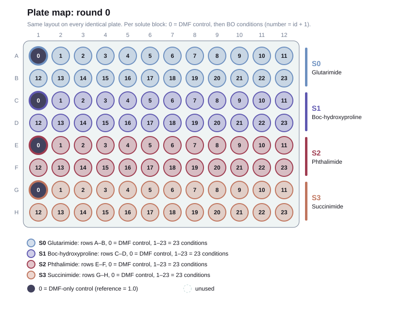
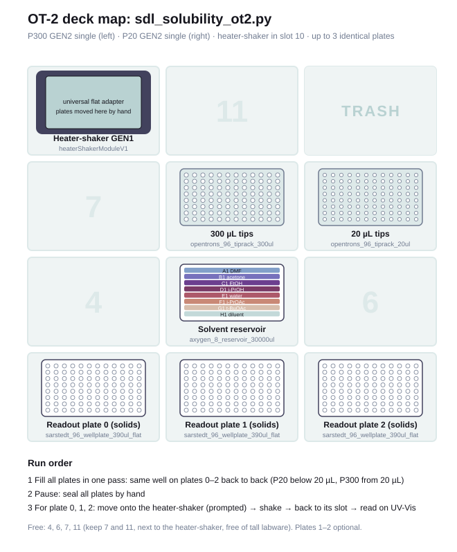

# OT-2 protocol: green-solvent kinetic solubility screen

One round = one run of [`sdl_solubility_ot2.py`](sdl_solubility_ot2.py) = up to 3
**identical** UV-Vis readout plates. Solids are pre-loaded in the readout plates, and the
solvent mixtures are made directly in them. Each well gets **300 µL**, made of 1–3 green
solvents in the ratio BO picks. DMF controls get 300 µL of pure DMF.

## Plate map



Default layout; solutes, solvents, troughs, volumes and numbering come from
[`../production/config.toml`](../production/config.toml), the rest from `bo_bridge.py`:
- **Solutes:** 4 solutes (Glutarimide, Boc-hydroxyproline, Phthalimide, Succinimide), each
  with an equal block of consecutive wells in row order. With 4 solutes that's 24 wells,
  i.e. **2 rows per solute**.
- **Controls:** each block starts with **1 DMF-only control**, the reference used to
  compute relative solubility.
- **BO conditions:** the other **23 wells** of each block are **BO conditions**, each a
  mixture of 1–3 of the 6 green solvents: acetone, EtOH, i-PrOH, water, i-PrOAc and t-BuOAc
  (CSV names `acetone, EtOH, iPrOH, water, iPrOAc, tBuOAc`).
  Pairs listed under `[[forbidden_pairs]]` in the config (water with either ester, immiscible) are
  skipped by `grid` and rejected by `layout`.
- **Numbering starts at 0:** rounds (`round0`), plates (`plate0`–`plate2`), condition
  counters (`R0_grid00`) and replicates. Well names stay `A1`–`H12`.

Change the layout with flags on `grid` and `layout` (or the constants at the top of `bo_bridge.py`):

| flag | default | effect |
|---|---|---|
| `--solutes A,B,...` | the 4 config solutes | wells per solute = 96 / number of solutes |
| `--controls-per-solute` | 1 | DMF wells per solute per plate |
| `--replicates` | 1 | wells per condition per plate (2 → 11 conditions per solute) |
| `--total-ul` (layout) | 300 | liquid per well |
| `--plates` (layout) | 3 | identical plates, only for the reservoir fill sheet |

Conditions per solute = (wells per solute − controls) ÷ replicates. The robot CSV lists
every well, so the protocol needs no changes when the layout changes. Draw any layout with
(solute blocks are labelled S0, S1, ... in `production/config.toml` order):

```bash
uv run python tools/draw_plate_map.py ../data/runs/round0/plate_map_round0.csv ../data/runs/round0/plate_map.svg
```

## Loop

```
bo_bridge.py grid / your BO ──► suggestions_roundN.csv   (frac_<solvent>, optional solute column)
bo_bridge.py layout          ──► ot_input_roundN.csv      (upload to sdl_solubility_ot2.py)
                                 plate_map_roundN.csv     (keep for merge / plate-svg)
OT-2 run                     ──► 3 identical plates ──► plate reader ──► one export per plate
bo_bridge.py merge           ──► bo_dataset.csv           (one row per solute × condition)
                                 bo_dataset_shared.csv    (conditions run on every solute)
```

```bash
python bo_bridge.py grid --round 0 -o ../data/runs/suggestions_round0.csv
```
```bash
python bo_bridge.py layout --round 0 --suggestions ../data/runs/suggestions_round0.csv --outdir ../data/runs/round0
```
```bash
python bo_bridge.py merge --plate-map ../data/runs/round0/plate_map_round0.csv --reader ../data/runs/round0/plate0.csv ../data/runs/round0/plate1.csv ../data/runs/round0/plate2.csv --dataset ../data/runs/bo_dataset.csv
```

`bo_bridge.py` uses only the standard library (Python 3.11+). See `examples/` for a complete round-0 set.

## File formats

**BO → `suggestions_roundN.csv`**: one row per condition, with `frac_<solvent>` columns
giving the solvent ratio. Missing columns count as 0, and rows are renormalised to sum to 1
and scaled to 300 µL. Optional columns:
- `solute`: empty means the condition runs on **every** solute (a shared condition).
  Filled in, it runs on that solute only. This lets BO either optimise one mixture for
  all solutes, or each solute separately, or both in the same round.
- `condition_id`: generated if omitted.

Each solute can take at most "conditions per solute" rows (23 by default). Unfilled wells
stay empty.

**`bo_dataset.csv`**: one row per round × solute × condition:

| column | meaning |
|---|---|
| `round, solute, condition_id` | identifiers |
| `is_reference` | 1 = DMF control. Exclude from the BO training set |
| `frac_<solvent>` | fractions **actually dispensed** (after rounding/snapping). Use these as BO inputs |
| `n_obs` | wells × plates pooled (3 with defaults) |
| `abs_mean, abs_std` | absorbance (minus `--blank` if given) |
| `rel_mean, rel_std` | relative to that solute's DMF control (mean over all plates) |

**`bo_dataset_shared.csv`**: one row per condition that ran on every solute, with
`rel_<solute>_mean` columns plus `obj_min_rel` (worst solute, i.e. "dissolves all of them",
to maximise) and `obj_mean_rel`. Re-running `merge` for a round replaces that round's rows
in both files.

**Plate reader exports**: one file per plate, passed to `--reader` in plate order. Each
can be either a long table with a `Well` column (`A1`/`A01`, plus an optional wavelength
column; pick one with `--wavelength`, or set `SOLUTE_WAVELENGTH_NM` for a different
wavelength per solute), or an 8×12 grid with a row letter in the first cell. To subtract
solvent background pass a blank export as `--blank`: either a solvent-only plate with the same
layout, or the per-well blank that `python -m analysis reduce` builds from the QC plate's
pure-solvent wells (`endpoint_roundN_blank.csv`; see `../analysis/README.md`). `analysis reduce`
also turns full-spectrum exports into the single-value files this command takes.

## What the robot does

1. **Fill all plates in one pass:** for each solvent, one tip per pipette. The P20 handles
   volumes under 20 µL and the P300 everything from 20 µL up. Each tip aspirates enough for
   several dispenses and fills the **same well on plates 0, 1, 2 back to back**, dispensing
   from above with an air gap between shots. Leftover goes back to the trough. Tips only
   touch their own solvent, so a full round uses about 7 tips.
2. **Pause:** you seal all plates by hand straight away, so plates 1–2 don't evaporate while
   plate 0 shakes.
3. **For plate 0, 1, 2 in turn:** the app prompts you to move the plate onto the
   heater-shaker. It shakes (default 20 min, 800 rpm), then you're prompted to put it back,
   and it can go to the UV-Vis reader.

My rough estimate is 1.5–2 h of pipetting for 3 full plates (about 530 aspirations,
mostly P300), plus 3 × 20 min shaking: about 3–3.5 h per round including sealing, the last
read and BO, so 3 rounds fit in about 10 h. These are estimates (the simulator doesn't
report run time), so time a dry run with water first. Refill the solvent troughs between
rounds using the fill sheet from `layout`, when you load the next solid plates.

**App settings:** identical plates (1–3), start at (fill / shake plate 0–2, to resume),
shake speed, shake time, temperature.

## Deck (OT-2)



| | 1 | 2 | 3 |
|---|---|---|---|
| **back (10–12)** | heater-shaker + universal flat adapter (10) | – (11) | trash (12) |
| **7–9** | – (7) | P300 tips (8) | P20 tips (9) |
| **4–6** | – (4) | solvent reservoir `axygen_8_reservoir_30000ul` (5) | – (6) |
| **front (1–3)** | readout plate 0 | readout plate 1 | readout plate 2 |

Pipettes: P300 GEN2 single on the left mount, P20 GEN2 single on the right (`PIPETTES` in
the protocol).

Reservoir troughs (25 mL each, from `production/config.toml`; `SOLVENT_TROUGHS` in the protocol
is a hand-kept mirror checked by the tests): A1 DMF, B1 acetone, C1 EtOH, D1 i-PrOH, E1 water,
F1 i-PrOAc, G1 t-BuOAc, H1 diluent. With this volume model the diluent isn't used. The protocol
fills from it only if a CSV has a `vol_diluent_ul` column. `layout` prints how much each solvent
needs per round; round 0 needs up to about 14.4 mL per solvent.

Slots 7 and 11, next to the heater-shaker, are kept free of tall labware.

## Before running

- Import the custom labware JSONs from `labware/` into the Opentrons app (Labware → Import).
- **Shake speed:** 300 µL in a 390 µL flat-bottom well is fairly full, so check at your
  shake speed that the seal holds and nothing splashes.
- **Plate material:** the readout plates are polystyrene; see Known limitations below.
- **Undissolved solid:** since nothing is filtered, any solid left in the well is in the
  light path and scatters. Let plates settle before reading.
- **Smallest component:** `MIN_UL = 5` µL (about 1.7% of 300 µL). Smaller components get
  snapped to 0 or 5 µL, and `layout` warns when it does this.

## Known limitations

**Polystyrene readout plates (possible confounder).** The readout plate,
`sarstedt_96_wellplate_390ul_flat`, is Sarstedt 83.3924, a polystyrene (PS)
tissue-culture plate. Several solvents in this screen can attack polystyrene
(`attacks_polystyrene` in `production/config.toml`):
- **Strong attack:** acetone, the esters (i-PrOAc, t-BuOAc) and DMF.
- **No attack expected:** EtOH, i-PrOH and water.

Attack shows up as clouding, crazing or softening of the well bottom. That raises the
measured absorbance without any extra solute dissolving, so affected solvents can look
more soluble than they are. The size of the effect depends on the solvent, its fraction
in the mixture and the contact time, so it can bias BO toward the most aggressive
solvents. It can also leach polystyrene into solution, which absorbs in the UV below
about 290 nm.

We use these plates anyway because no plate in the Opentrons labware library is both
non-polystyrene and suitable for absorbance. Every flat-bottom plate there is
polystyrene, and the polypropylene plates have U- or V-bottom wells and are not
UV-transparent.

To limit and measure the effect:
- **Blank wells:** the QC plate (`python -m analysis qc-layout`, one extra 1-plate run per
  round) holds solvent-only wells; `analysis reduce` combines them into a per-well blank for
  `merge --blank`, and `analysis qc` checks whether acetone- and ester-rich blanks read high
  and whether they grow with the read delay. A full solvent-only copy of the sample plate
  (same `ot_input` CSV, no solids) also works as `--blank` and sees exactly the same solvent
  and contact time per well.
- **Consistent timing:** read each plate soon after shaking, and keep the timing the same
  every round.
- **Check plates by eye:** look for cloudy or warped wells before reading, and note any.
- **Report it:** treat results for acetone- and ester-rich mixtures with caution, and report
  the plate material as a limitation.
- **Better fix:** a quartz or glass-bottom plate with a custom labware definition
  (change `READOUT_PLATE` in the protocol).

## Checking changes

Simulated with `opentrons_simulate` (opentrons 8.8.2, apiLevel 2.27, OT-2). Newer opentrons
packages refuse to simulate OT-2 protocols; the repo's uv environment (`../setup.sh`) pins `opentrons==8.8.2` (Python 3.12).
```bash
uv run opentrons_simulate -L labware sdl_solubility_ot2.py
```

`tools/check_all.py` runs the full set: every protocol setting, the expected-error cases,
a two-round BO loop with fake plate-reader data, and a check that the Flex timing analog
(`../OTFlex analog/`) runs exactly the same liquid handling (31 checks).
```bash
uv run python tools/check_all.py
```

`tools/draw_deck_map.py` redraws `maps/deck_map.svg`. Trough labels come from
`production/config.toml`; slot assignments are static, so update them if you move labware in
the protocol. `tools/draw_plate_map.py` redraws `maps/plate_layout.svg` from
`examples/plate_map_round0.csv` (or any plate map, see above).

## Folder layout

```
OT protocols/
├── sdl_solubility_ot2.py   OT-2 protocol (upload to the Opentrons app)
├── bo_bridge.py            grid / layout / merge / plate-svg (runs on a laptop)
├── labware/                custom labware JSONs (import into the Opentrons app)
├── examples/               round-1 suggestions, robot CSV and plate map
├── maps/                   plate_layout.svg, deck_map.svg
├── tools/                  check_all.py, draw_deck_map.py, draw_plate_map.py
└── archive/                earlier Flex version (not maintained)
```

The earlier Flex version (96-channel in single-tip mode, gripper, lids) is in
`archive/sdl_solubility_flex.py`. It reads the same CSV format but isn't maintained.
