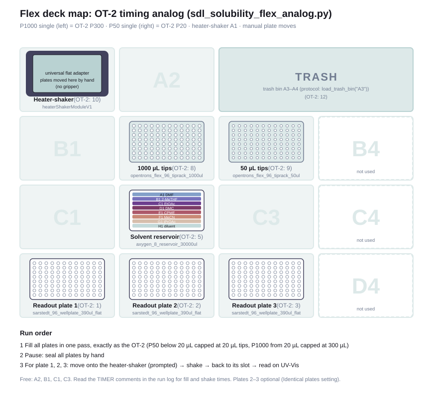

# OTFlex analog: time one OT-2 round on a Flex

[`sdl_solubility_flex_analog.py`](sdl_solubility_flex_analog.py) replays the OT-2 protocol
(`../OT protocols/sdl_solubility_ot2.py`) on a Flex with two single-channel pipettes, so
you can time one round of dispensing and shaking before the real run.

## What is identical

The simulator confirms both protocols run the same **2,900 liquid-handling steps** on the
round-1 plate: same volumes, wells, order, flow rates, delays, air gaps, pre-wet and blow-outs.
That's 531 aspirations, 636 dispenses and 7 tips (`../OT protocols/tools/check_all.py`
re-checks this).

| OT-2 | Flex analog | How it's kept the same |
|---|---|---|
| P20 GEN2 single (right) | P50 single, `flex_1channel_50` (right) | Gets every dispense < 20 µL; works with a 20 µL tip capacity |
| P300 GEN2 single (left) | P1000 single, `flex_1channel_1000` (left) | Gets every dispense ≥ 20 µL; works with a 300 µL tip capacity |
| Flow rates, blow-out rate, 400 mm/s gantry speed | same values set explicitly | Flex defaults are different, so they're overridden |
| Manual plate moves to the heater-shaker | manual | The gripper is never used |

Capping the Flex tips at the OT-2 capacities matters. Otherwise the P1000 would fill
~950 µL per aspiration and need about 5× fewer trips, which would make the Flex time far
too optimistic.

## What still differs

These make the Flex timing an approximation, not an exact prediction:
- **Slot spacing:** Flex slots are about 20% further apart than OT-2 slots, so moves are a
  bit longer.
- **Mechanics:** tip pickup/drop, homing and z-travel heights differ between the robots.
- **Small pipette:** the P50's minimum is 5 µL against 1 µL for the P20. CSVs from
  `bo_bridge.py` never go below 5 µL, so this doesn't matter here.

## Deck



OT-2 slots mapped one-to-one onto the Flex:

| OT-2 slot | Flex slot | Contents |
|---|---|---|
| 10 | A1 | heater-shaker + universal flat adapter |
| 12 | A3 (bin spans A3–A4) | trash bin |
| 8 | B2 | 1000 µL tips (Flex) |
| 9 | B3 | 50 µL tips (Flex) |
| 5 | C2 | solvent reservoir `axygen_8_reservoir_30000ul` |
| 1, 2, 3 | D1, D2, D3 | readout plates 1–3 |

If your Flex has the waste chute in D3, set **Trash = Waste chute (D3)**. Plate 3 then moves
to C3.

## Running a timing test

1. Import `sarstedt_96_wellplate_390ul_flatbottom.json` and `axygen_8_reservoir_30000ul.json`
   from `../OT protocols/labware/` into the Opentrons app.
2. Upload this protocol with `../OT protocols/examples/ot_input_round1.csv` as the CSV
   (a full 96-well, 3-plate round).
3. **Liquids:** water is fine for timing. No solids are needed; empty plates work.
4. **Settings:**
   - Trash: **Trash bin (A3)**, the default; matches your Flex's bin in A3–A4.
   - Shake time: 20 min, to match the real run.
   Plate moves are always manual (no gripper), like the OT-2.
5. Read the times off the run log in the Opentrons app (each command has a timestamp). The
   protocol adds `TIMER: fill start`, `TIMER: fill end`, and `TIMER: shake start/end
   Readout plate N` comments to make the sections easy to find.

Expected from the plan:
- **Filling:** about 1.5–2 h for 3 plates. That's the number to measure.
- **Shaking:** 3 × 20 min, plus your manual moves.

`tools/draw_deck_map.py` redraws `deck_map.svg`. It's a static drawing, so update it if you
move labware.

Simulated with `opentrons_simulate` (opentrons 8.8.2, apiLevel 2.27, Flex):
```bash
opentrons_simulate -L "../OT protocols/labware" sdl_solubility_flex_analog.py
```
