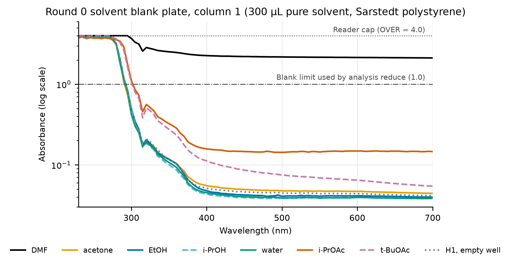
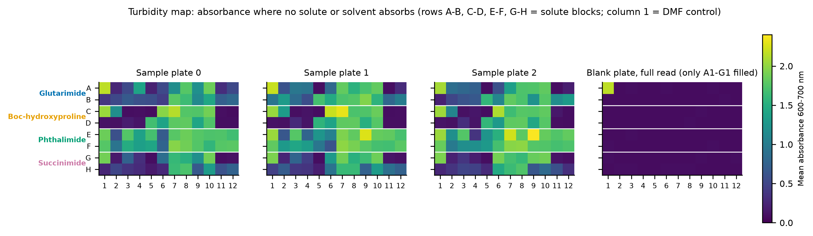
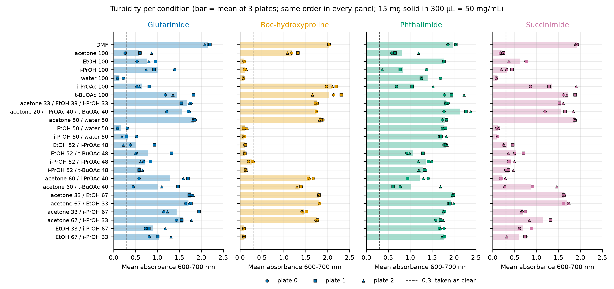
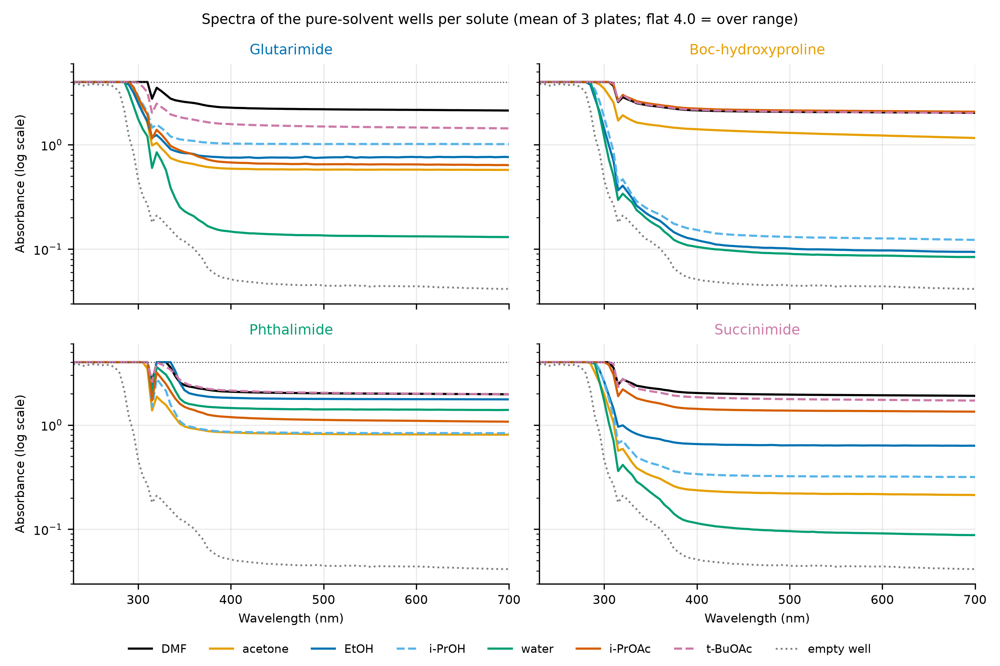

# Round 0 results: analysis summary

Written 2026-10-29 from the files the lab returned on 2026-10-28 (`Magdalena.xlsx`, the OT-2 run log `magdalena_SDL Solubility_ ... .json`, `comments.txt` and the five Excel screenshots). Figures and the turbidity table are regenerated with `PYTHONPATH=. uv run python data/Results/make_figures.py` from the repo root.

## Summary

The round 0 plates cannot be analysed for the intended objective, the UV absorbance of each solute relative to its DMF control. Three independent problems each prevent it. First, the polystyrene readout plate absorbs above 3.5 at every wavelength below about 285 nm, even when empty, so every solute band at or below 300 nm is hidden. Second, pure DMF on a solid-free plate reads about 2.1 at all wavelengths from 400 to 700 nm, so the DMF control wells are opaque from plate attack and are not a valid reference. Third, every sample well with solid is turbid to some degree, so the visible-range absorbance is dominated by scattering. The production pipeline (`production/run_bo.sh`) stops at its first step on these files because no wavelength has every solvent blank below the 1.0 limit, and no BO round 1 was proposed. A second iteration was not run by the lab in any case (`comments.txt`).

What the data do support is a qualitative clear or turbid call per well, from the mean absorbance between 600 and 700 nm, where neither the solutes nor the solvents absorb. With 15 mg of solid in 300 µL (50 mg/mL), a clear well means the solid dissolved at 50 mg/mL or more, and a turbid well means solid remained or the well was compromised. Of the 92 non-DMF conditions (23 per solute), 18 are clear: 11 for Boc-hydroxyproline, 2 for glutarimide, 5 for succinimide and none for phthalimide. The clear calls agree with the published solubilities that bracket 50 mg/mL, which gives some confidence in this readout. Before these calls are used, the solid-dosing layout and the shaking of plates 1 and 2 need to be confirmed with the lab (see "Questions for the lab").

## What was run

| Item | Planned (repo) | As run (lab files) |
|---|---|---|
| Robot input | `ot_input_round0.csv`, 3 plates, backup reservoir, blank plate column 1 | same file and settings; 600 rpm, 20 min shaking, ambient temperature |
| Solid | highest DMF pre-test level that dissolves | 15 mg per well (50 mg/mL), dosed on a Chemspeed platform with 0.5 mg tolerance, "not standard layout" |
| Scan | 200–700 nm, 5 nm steps | 230–700 nm, 5 nm steps, 95 wavelengths; the reader cannot read below 230 nm |
| Reader files | one workbook per plate, `reader_round0_plate{0,1,2}.xlsx` and `reader_round0_solvents.xlsx` | one workbook with five sheets: `plate0`, `plate1`, `plate2`, `Reader_roundN_solvents.xlsx` (A1–H1 only) and `solvent_round0_fullplate` (the blank plate read again, all 96 wells) |

The reader is a Tecan Infinite 200 PRO (Sarstedt 83-3924 flat-bottom polystyrene plate definition), and over-range cells are written `OVER`, which the pipeline reads as 4.0. This answers the open question on the reader's export format and range: 230 to 700 nm here, with a practical ceiling near absorbance 4.

The run log shows the fill ran from 11:52 to 14:23, then plate 0 was moved onto the heater-shaker at 14:27 and returned at 15:04. Plate 1 was placed on the shaker at 15:05:00 and the run was paused and stopped 32 s later, at 15:05:32, so the log records 20 min of shaking for plate 0 only. The plates were read 5 to 8 h after filling.

| Plate | Read start | Temperature in the reader |
|---|---|---|
| Blank plate, column 1 | 19:28 | 26.2 °C |
| Sample plate 0 | 20:08 | 25.5 °C |
| Sample plate 1 | 21:19 | 31.2 °C |
| Sample plate 2 | 22:05 | 27.9 °C |
| Blank plate, full read | 22:44 | 27.5 °C |

## Findings

### 1. The polystyrene plate sets a UV floor near 300 nm

The empty well H1 of the blank plate reads above 3.5 from 230 to 280 nm, falls to about 0.46 at 300 nm and is below 0.1 only above about 370 nm (Figure 1). Water, ethanol and i-PrOH follow the empty-well curve, so the plate, not the solvents, sets the cut-off. The two esters add 0.1 to 0.5 between 300 and 400 nm and keep a raised baseline to 700 nm (i-PrOAc 0.15, t-BuOAc 0.05 above the empty well's 0.04), which is consistent with mild attack on the polystyrene. The band maxima of succinimide (230–250 nm), glutarimide and Boc-hydroxyproline (below 210 nm) and phthalimide (about 295 nm) all lie in the region the plate blocks, as anticipated in `docs/uv_saturation_estimate.md`. A UV readout of these solutes needs UV-transparent plates (quartz or UV-Star type), which would also remove the plate's own cut-off.

**Figure 1.** Spectra of the round 0 column of the solvent blank plate. Every well, including the empty H1, is over range below about 285 nm, and the DMF well A1 stays above 2 at every wavelength.

### 2. DMF attacks the plate, so the DMF control is invalid

Pure DMF with no solid reads 2.15 at 700 nm on the blank plate, the same value as the DMF control wells on the sample plates (2.15, 2.04, 1.98 and 1.91 for the four solute blocks), while every other blank well reads below 0.15 (Figure 2). The DMF control signal therefore comes from the dissolved or crazed polystyrene, not from the solute, and the relative-to-DMF objective cannot be computed from these plates. `production/config.toml` already marks DMF as `attacks_polystyrene = true`. The DMF well also blocks the pipeline's usable-window search: `analysis reduce` with the default blank limit of 1.0 finds no usable wavelength, and with the limit raised to 2.5 it reads in 360–700 nm and marks Boc-hydroxyproline, phthalimide and succinimide not measurable because their DMF controls lie below the predicted blank there.

### 3. Acetone is absent from the acetone wells at read time

Acetone's UV cut-off is about 330 nm (absorbance 1 in a 1 cm cell), so a 300 µL acetone well (8.8 mm path) should read well above 1 below 330 nm and over range a little below that. The acetone blank well B1 instead reads 0.43 at 300 nm and 0.20 at 320 nm, within 0.03 of the empty well, and the pure-acetone sample wells saturate only up to 280–305 nm, like the water wells. The most likely explanation is that the acetone evaporated during the 2.5 h open fill and the 5–8 h before reading, or through the seal. Loss of acetone from a mixture would also explain why every acetone-rich binary and ternary mixture is turbid for all four solutes (about 1.4 to 1.9 at 600–700 nm), including acetone/water 50:50 with succinimide and Boc-hydroxyproline, which dissolve in water alone. Results for any acetone-containing condition should therefore be set aside. The esters and alcohols are much less volatile, and their blank spectra show no comparable loss, although this cannot be checked for liquids that do not absorb above 300 nm.

### 4. Turbidity gives a usable clear or turbid call

Figure 2 maps the 600–700 nm mean on every plate, and Figure 3 lists it per condition with each plate as a separate marker. Wells fall into two groups, below about 0.3 (clear, close to the 0.04–0.15 of solid-free solvent wells) and above about 0.5 (turbid, up to about 2.4). A threshold of 0.3 separates them for most conditions, and the plate-to-plate spread is small for Boc-hydroxyproline (median standard deviation 0.015) but larger for succinimide (0.08), phthalimide (0.09) and glutarimide (0.19).

**Figure 2.** Mean absorbance between 600 and 700 nm per well, on the plate map of `plate_map_round0.csv`. Column 1 of each solute block is the DMF control.

**Figure 3.** Turbidity per solute and condition. Bars are the mean of the three plates, and the circle, square and triangle markers are plates 0, 1 and 2. The dashed line marks the 0.3 threshold used for the clear calls below.

The clear conditions, with acetone-containing ones marked as unreliable, are listed below (full table: `figures/turbidity_600_700nm.csv`).

| Solute | Clear at 50 mg/mL (mean A600–700 below 0.3) |
|---|---|
| Boc-hydroxyproline | EtOH, i-PrOH, water, EtOH/water 50:50, i-PrOH/water 50:50, EtOH/i-PrOAc 52:48, EtOH/t-BuOAc 52:48, i-PrOH/i-PrOAc 52:48, i-PrOH/t-BuOAc 52:48, EtOH/i-PrOH 33:67 and 67:33 |
| Glutarimide | water, EtOH/water 50:50 |
| Phthalimide | none |
| Succinimide | water, EtOH/water 50:50, i-PrOH/water 50:50; acetone and acetone/i-PrOAc 60:40 are also clear but unreliable (finding 3) |

These calls agree with the literature values collected in `docs/uv_saturation_estimate.md`. Phthalimide dissolves only about 6 mg/mL in ethanol and i-PrOH and about 26 mg/mL in acetone at 25 °C, all below the 50 mg/mL load, and it is turbid in every solvent. Succinimide dissolves about 330 mg/mL in water and about 42 mg/mL in ethanol at 20 °C, and it is clear in water and moderately turbid in ethanol (0.63). Boc-hydroxyproline dissolves at 50 mg/mL or more in both alcohols, in water and in alcohol/ester mixtures, but not in the pure esters. Glutarimide needs water: it is clear only in water and EtOH/water, while the pure alcohols and the alcohol/water mixtures with i-PrOH are borderline (0.34 for i-PrOH/water) or turbid.

Within the 23 seed conditions, EtOH/water 50:50 is the only mixture that is clear for glutarimide, Boc-hydroxyproline and succinimide together, and water alone does the same. No condition is clear for phthalimide at this load, so a lower phthalimide load would be needed to rank solvents for it. These are solubility thresholds at 50 mg/mL, not solubility values, and they cannot rank conditions that are all clear or all turbid.

### 5. The UV region carries little extra information

Figure 4 shows the full spectra of the pure-solvent wells. Phthalimide stays over range up to 330–335 nm in ethanol, i-PrOH, DMF and most mixtures, compared with 280–310 nm for the other solutes, which matches phthalimide's weak 300–330 nm band and shows that some phthalimide is dissolved. The scattering of turbid wells rises toward the UV as well, however, so this edge cannot be separated from turbidity without a filtered or centrifuged supernatant. Every spectrum also shows a dip at 315 nm, an instrument artefact where the reader switches from a 5 nm to a 9 nm bandwidth (316 nm, rows 21–22 of the workbook header).

**Figure 4.** Spectra of the six pure-solvent wells and the DMF control for each solute, averaged over the three plates, with the empty blank-plate well for reference.

### 6. Data integrity checks

All five sheets parse with the repo's reader-workbook parser (`production/convert_reader_xlsx.py`), each with 95 wavelengths, and the sample sheets each hold 96 wells. The full re-read of the blank plate 3 h after the first read agrees with it to within 0.06 at 700 nm and 0.15 at 300 nm. The solvent blank sheet covers A1–H1 as planned, and the sample plates contain between 1460 and 1480 over-range cells each, 245–257 of them above 290 nm, mostly in the phthalimide block.

## Questions for the lab

1. **Solid-dosing layout.** `comments.txt` says the Chemspeed dosing used a "not standard layout". Every result above assumes the solutes sit in the blocks of `plate_map_round0.csv` (rows A–B glutarimide, C–D Boc-hydroxyproline, E–F phthalimide, G–H succinimide). The block-to-block differences in Figure 2 look solute-specific, but if the solids were placed differently, the per-solute calls must be remapped.
2. **Shaking of plates 1 and 2.** The run log stops 32 s after plate 1 went onto the heater-shaker, so plates 1 and 2 may not have been shaken by the robot. Were they shaken elsewhere, and for how long?
3. **Sealing and timing.** When were the plates sealed relative to the 2.5 h fill, and with which seal? This decides whether acetone loss happened during the fill or the wait.

## Recommendations for a next round

- **Plates.** Use solvent-resistant UV-transparent plates, or glass vials with a transfer to quartz, so DMF and the esters do not attack the plate and the 230–300 nm region becomes readable.
- **Readout.** Filter or centrifuge before reading and dilute the supernatant into a UV-transparent solvent, as the loads still put phthalimide above absorbance 4 (`docs/uv_saturation_estimate.md`). Without that, record turbidity at 600–700 nm explicitly as the readout and design the BO objective around it.
- **Volatility.** Seal each plate as soon as it is filled, or exclude acetone, because acetone loss over hours of filling and waiting invalidates every acetone-containing well.
- **Load.** Choose loads around the solubility thresholds of interest, for example lower for phthalimide, since 50 mg/mL leaves phthalimide turbid everywhere and Boc-hydroxyproline clear in most solvents.
