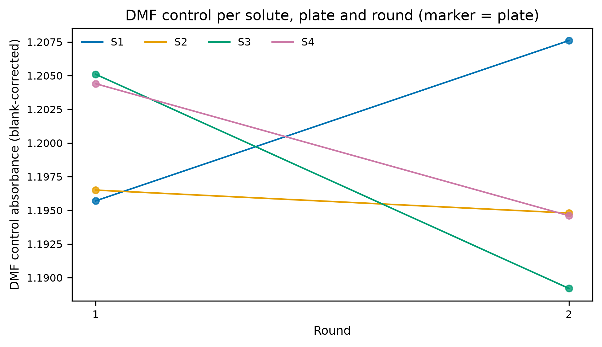
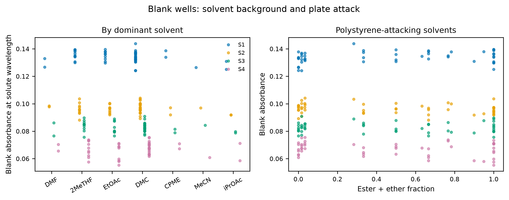
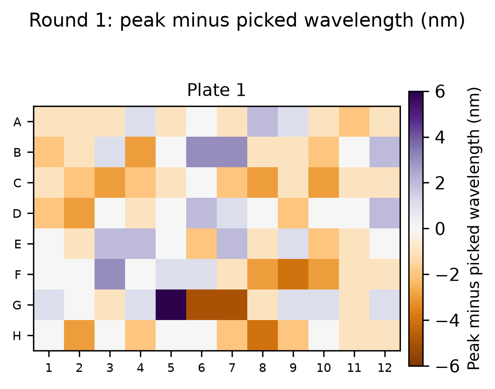
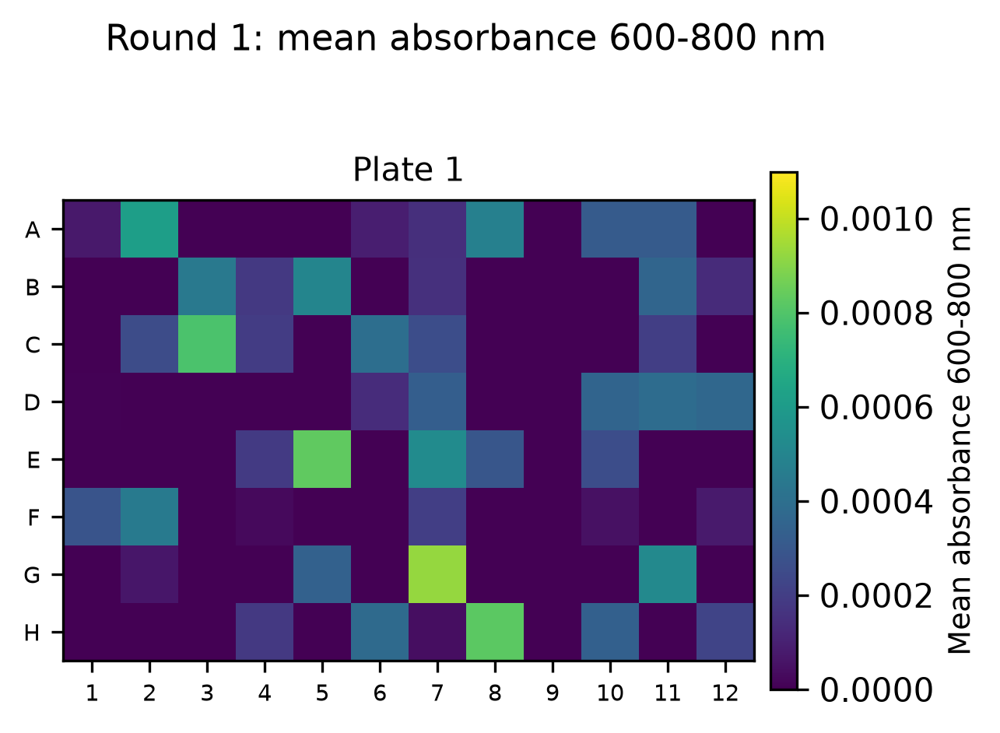
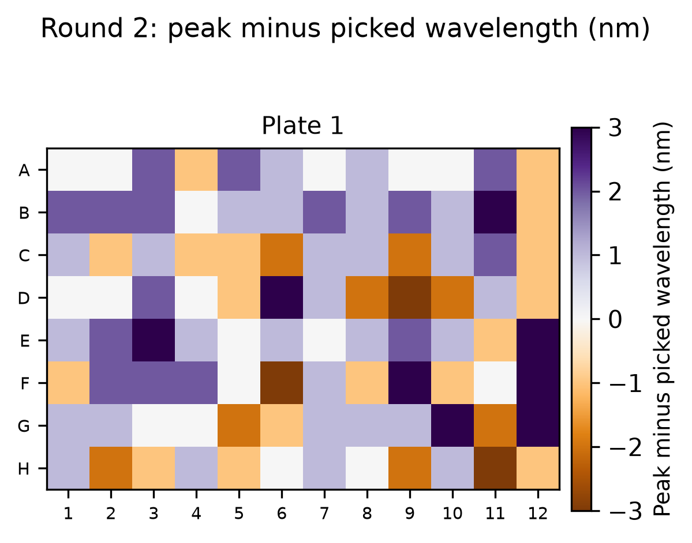
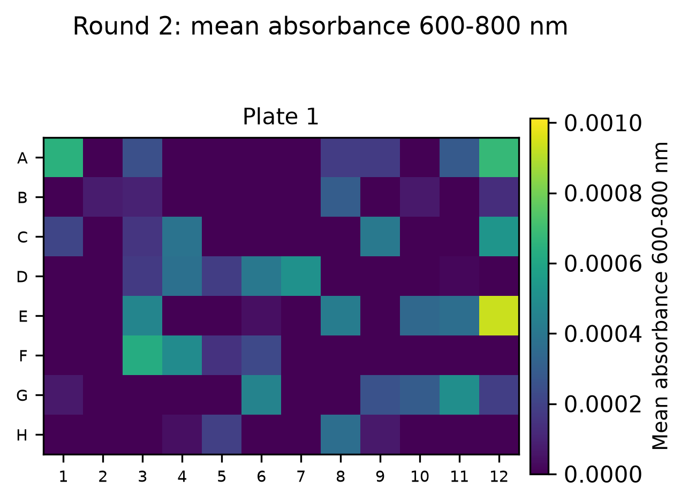
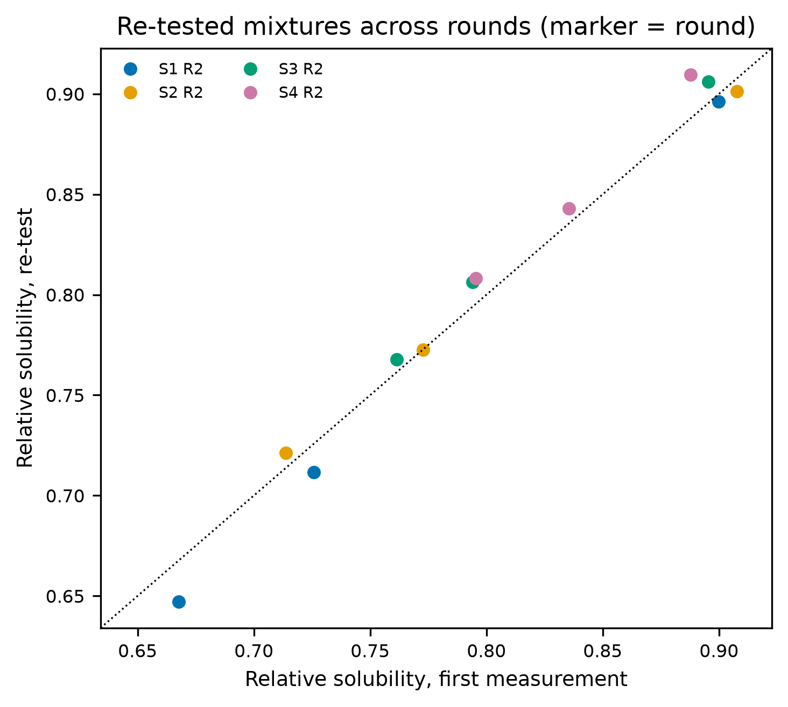

# QC summary: toy_additive_output_one_plate (rounds 1, 2)

## Q1 plate-to-plate reproducibility

- Median CV across identical plates is the noise floor a mixture must beat to count as better.
- A plate is flagged when its median deviation from the other plates exceeds 5%.

| round | solute | n_plates | median_cv | flagged_plate |
|---|---|---|---|---|
| 1 | all | 1 |  |  |
| 2 | all | 1 |  |  |

## Q2 control stability

- Every relative value is divided by its round's control, so control drift between rounds rescales the whole round.
- Drift beyond the within-round CV means a different solid load, evaporation or plate attack.

| solute | round1_mean | max_drift_vs_round1 | within_round_cv |
|---|---|---|---|
| S1 | 1.196 | 0.010 |  |
| S2 | 1.196 | 0.001 |  |
| S3 | 1.205 | 0.013 |  |
| S4 | 1.204 | 0.008 |  |

## Q3 blank wells and plate attack

- b_<solvent>: blank absorbance of the pure solvent at that solute's wavelength (additive fit over all blank wells).
- Low R^2 or large residuals mean the blank is not additive in composition, i.e. plate attack or solvent interaction.
- Read-delay panel appears only when plate_log_roundN.csv files exist.

| solute | b_DMF | b_2MeTHF | b_EtOAc | b_DMC | b_CPME | b_MeCN | b_iPrOAc | resid_std | r2 |
|---|---|---|---|---|---|---|---|---|---|
| S1 | 0.130 | 0.137 | 0.135 | 0.133 | 0.136 | 0.133 | 0.131 | 0.004 | 0.132 |
| S2 | 0.098 | 0.096 | 0.096 | 0.097 | 0.096 | 0.098 | 0.092 | 0.003 | 0.092 |
| S3 | 0.081 | 0.086 | 0.083 | 0.083 | 0.083 | 0.083 | 0.077 | 0.003 | 0.178 |
| S4 | 0.068 | 0.068 | 0.064 | 0.069 | 0.065 | 0.065 | 0.065 | 0.005 | 0.095 |

## Q4 spectral QC

- Saturation: raw absorbance above 2.5 (reader linear range placeholder, PLAN Q-b).
- Peak shift needs full spectra and a band of at least 0.05 absorbance (grey = too weak); scattering needs readings at 600-800 nm (add a 700 nm read in fixed-wavelength mode).
- High scattering = undissolved solid in the light path, which inflates that well.

| round | n_saturated | saturated_wells | n_peak_shift_gt10nm | median_abs_peak_shift_nm | max_scatter_abs |
|---|---|---|---|---|---|
| 1 | 0 |  | 0 | 1.000 | 0.001 |
| 2 | 0 |  | 0 | 1.000 | 0.001 |

## Q5 precision against signal

- No replicate plates, so there is no within-condition spread to plot; detection limits only.

| solute | detection_limit_abs | frac_below_lod |
|---|---|---|
| S1 | 0.012 | 0.000 |
| S2 | 0.010 | 0.000 |
| S3 | 0.010 | 0.000 |
| S4 | 0.014 | 0.000 |

## Q6 cross-round re-tests

- Re-tests repeat a mixture on new solid, a new plate and a refilled reservoir: the only check across rounds.
- Grey band: 2 x the median plate-to-plate CV (Q1); frac_within_2cv uses each solute's own CV.

| solute | n_retests | mean_abs_diff | plate_cv | frac_within_2cv |
|---|---|---|---|---|
| S1 | 3 | 0.013 |  |  |
| S2 | 3 | 0.005 |  |  |
| S3 | 3 | 0.010 |  |  |
| S4 | 3 | 0.014 |  |  |

## Q7 calibration

- No QC plate (qc_plate_map_roundN.csv + reader_roundN_qc.csv) found.
