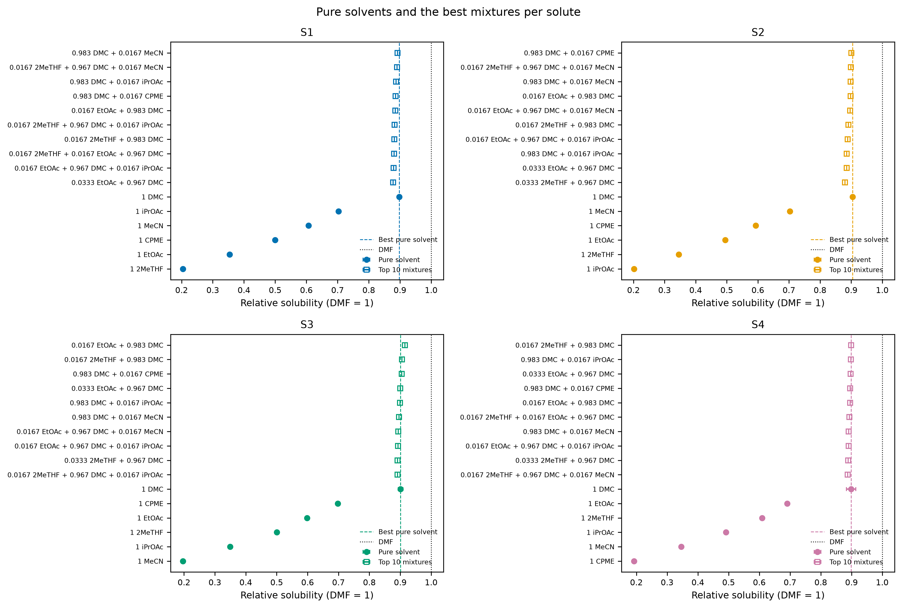
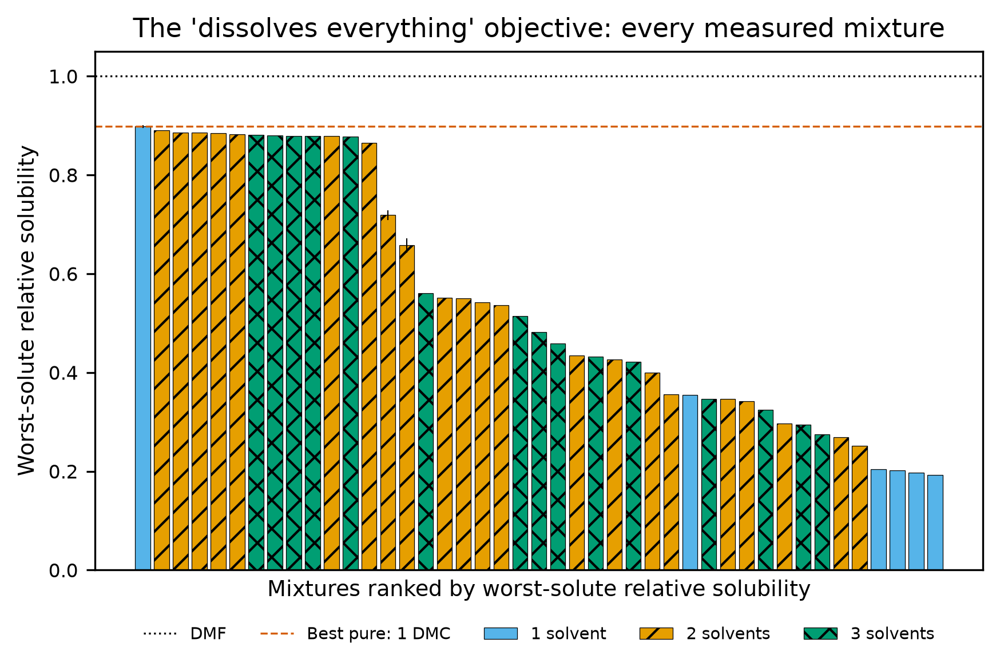
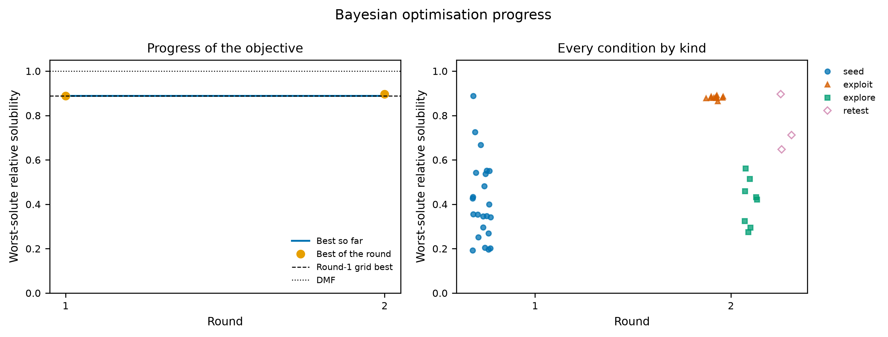
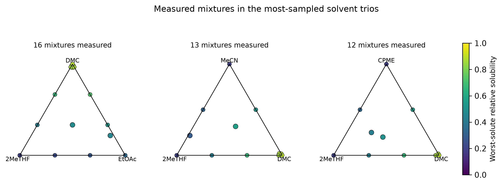
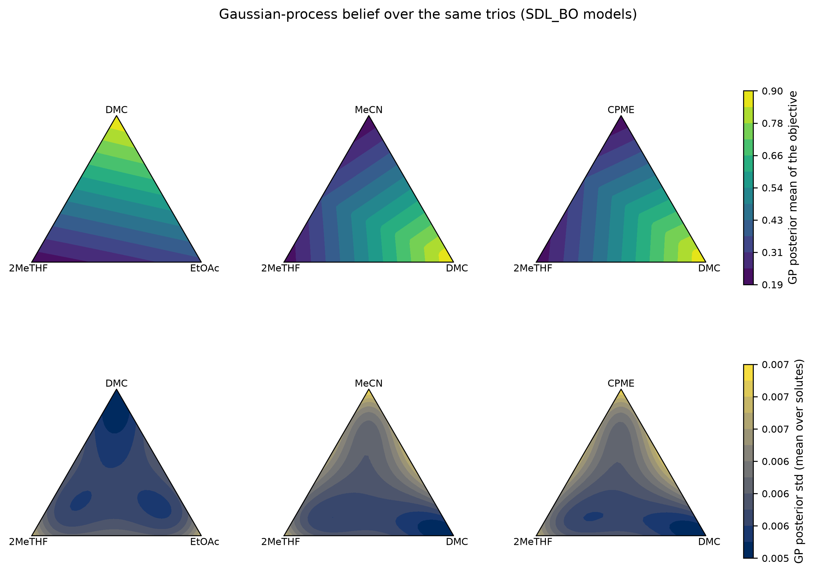
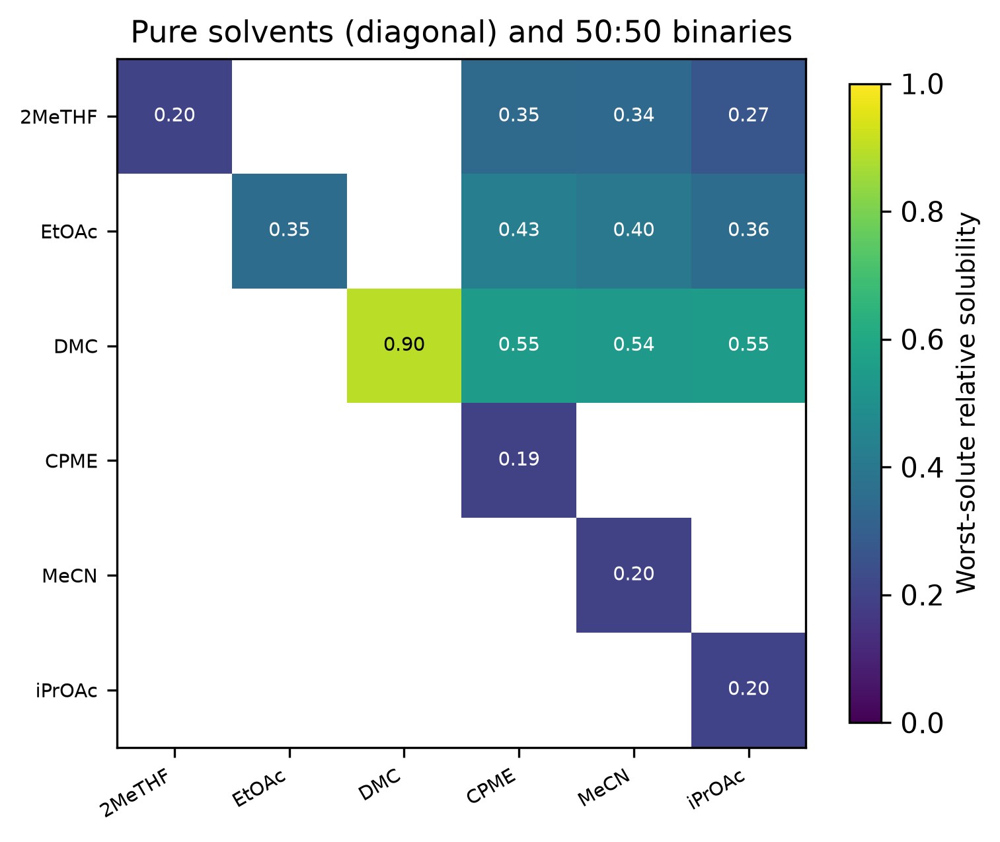
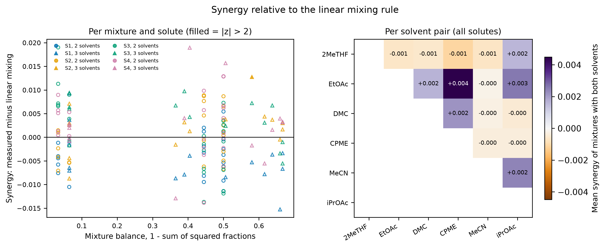
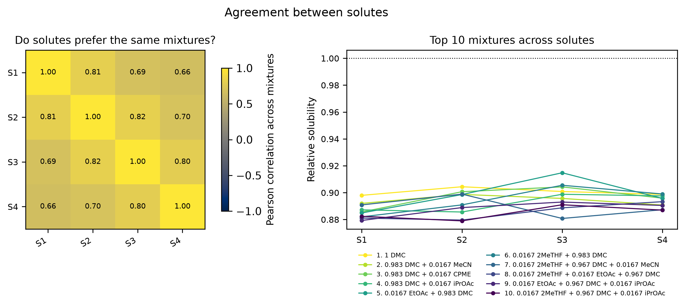
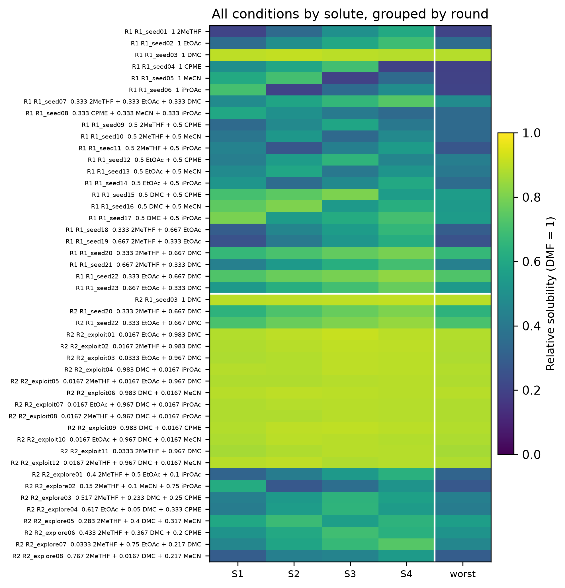

# Report: toy_additive_output_one_plate (rounds 1, 2)

## R1 mixtures vs single solvents, per solute

For each solute on its own, does any green-solvent mixture dissolve more than the best single green solvent, and how close does it come to DMF?

- z = difference over the combined error (within-plate and between-round spread); a mixture beats the best pure solvent when z > 2.

| solute | best_mixture | rel_mixture | best_pure | rel_pure | ratio | z | mixture_beats_pure |
|---|---|---|---|---|---|---|---|
| S1 | 0.983 DMC + 0.0167 MeCN | 0.892 | 1 DMC | 0.898 | 0.993 | -2.357 | False |
| S2 | 0.983 DMC + 0.0167 CPME | 0.901 | 1 DMC | 0.904 | 0.996 | -0.818 | False |
| S3 | 0.0167 EtOAc + 0.983 DMC | 0.915 | 1 DMC | 0.901 | 1.015 | 1.844 | False |
| S4 | 0.0167 2MeTHF + 0.983 DMC | 0.899 | 1 DMC | 0.899 | 1.000 | 0.019 | False |

## R2 the 'dissolves everything' objective

Is there one mixture that dissolves all solutes well at once, i.e. whose worst solute still beats the best single solvent's worst solute? This is the proposal's success criterion.

- Best overall: 1 DMC (0.898); best pure solvent: 1 DMC (0.898); z = 0.0 -> no mixture is clearly better than the best single solvent.

| rank | mixture | obj_min_rel | obj_err | worst_solute | n_solvents | first_round |
|---|---|---|---|---|---|---|
| 1 | 1 DMC | 0.898 | 0.003 | S1 | 1 | 1 |
| 2 | 0.983 DMC + 0.0167 MeCN | 0.891 | 0.000 | S4 | 2 | 2 |
| 3 | 0.983 DMC + 0.0167 iPrOAc | 0.886 | 0.000 | S2 | 2 | 2 |
| 4 | 0.983 DMC + 0.0167 CPME | 0.886 | 0.000 | S1 | 2 | 2 |
| 5 | 0.0167 EtOAc + 0.983 DMC | 0.885 | 0.000 | S1 | 2 | 2 |
| 6 | 0.0167 2MeTHF + 0.983 DMC | 0.882 | 0.000 | S1 | 2 | 2 |
| 7 | 0.0167 2MeTHF + 0.967 DMC + 0.0167 MeCN | 0.881 | 0.000 | S3 | 3 | 2 |
| 8 | 0.0167 2MeTHF + 0.0167 EtOAc + 0.967 DMC | 0.880 | 0.000 | S2 | 3 | 2 |
| 9 | 0.0167 EtOAc + 0.967 DMC + 0.0167 iPrOAc | 0.879 | 0.000 | S1 | 3 | 2 |
| 10 | 0.0167 2MeTHF + 0.967 DMC + 0.0167 iPrOAc | 0.879 | 0.000 | S2 | 3 | 2 |

## R3 BO progress

Is the Bayesian optimisation learning: does the best objective improve round on round, and do its exploit picks outperform its explore picks and the seed grid?

- Exploit picks should sit above explore picks once the model has learnt something; re-tests show cross-round repeatability.

| round | kind | n | mean | best |
|---|---|---|---|---|
| 1 | seed | 23 | 0.416 | 0.888 |
| 2 | exploit | 12 | 0.881 | 0.891 |
| 2 | explore | 8 | 0.410 | 0.561 |
| 2 | retest | 3 | 0.752 | 0.896 |

## R4 composition landscape

Where in composition space do the good mixtures lie, and what does the model believe about the regions it has not measured?

- Ternaries: colour = worst-solute relative solubility; larger points are 3-solvent mixtures. GP panels show the model the BO used.

| trio | n_mixtures |
|---|---|
| 2MeTHF / EtOAc / DMC | 16 |
| 2MeTHF / DMC / MeCN | 13 |
| 2MeTHF / DMC / CPME | 12 |

## R5 synergy

Do mixtures dissolve more than the fraction-weighted average of their pure solvents would predict, i.e. is there genuine synergy, and between which solvent pairs?

- Synergy > 0: the mixture dissolves more than the fraction-weighted average of its pure solvents would predict.

| solute | n_mixtures | mean_synergy | max_synergy | most_synergistic |
|---|---|---|---|---|
| S1 | 37 | -0.004 | 0.009 | 0.0167 2MeTHF + 0.967 DMC + 0.0167 MeCN |
| S2 | 37 | 0.001 | 0.013 | 0.4 2MeTHF + 0.5 EtOAc + 0.1 iPrOAc |
| S3 | 37 | 0.002 | 0.019 | 0.0167 EtOAc + 0.983 DMC |
| S4 | 37 | 0.003 | 0.019 | 0.15 2MeTHF + 0.1 MeCN + 0.75 iPrOAc |

## R6 agreement between solutes

Do the solutes prefer the same solvents, or is dissolving all of them a trade-off? Low correlation explains why the worst-solute objective is hard.

- Low or negative correlation means the solutes want different solvents: the worst-solute objective is then a real trade-off.

| solute | S1 | S2 | S3 | S4 |
|---|---|---|---|---|
| S1 | 1.000 | 0.805 | 0.685 | 0.658 |
| S2 | 0.805 | 1.000 | 0.818 | 0.698 |
| S3 | 0.685 | 0.818 | 1.000 | 0.797 |
| S4 | 0.658 | 0.698 | 0.797 | 1.000 |

## R7 dataset

The dataset deliverable: every condition measured on every solute, across rounds, as one picture and the files behind it.

- 46 condition rows over 2 round(s), 4 solutes.
- Deliverable files in the run folder: `bo_dataset.csv`, `bo_dataset_shared.csv`, `plate_map_round1.csv`, `plate_map_round2.csv`, `results_round1_wells.csv`, `results_round2_wells.csv`; QC numbers in `qc_summary.md`.

