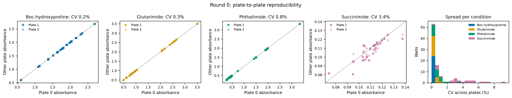
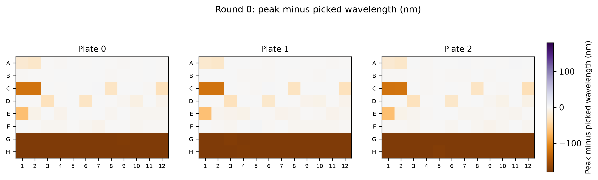
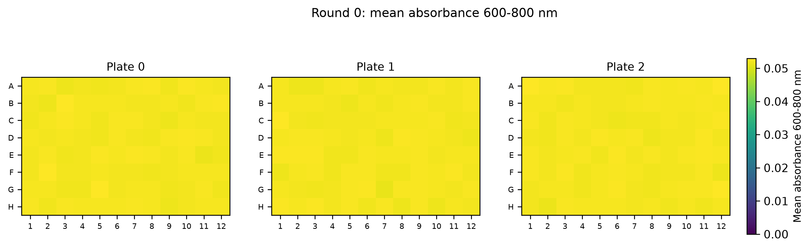

# QC summary: toy_synergy_output (rounds 0, 1, 2)

## Q1 plate-to-plate reproducibility

How well do the identical plates of a round agree, and is any plate systematically off? The spread sets the noise floor: a mixture must beat the best single solvent by more than this to count.

- Median CV across identical plates is the noise floor a mixture must beat to count as better.
- A plate is flagged when its median deviation from the other plates exceeds 5%.

| round | solute | n_plates | median_cv | flagged_plate |
|---|---|---|---|---|
| 0 | Boc-hydroxyproline | 3 | 0.002 |  |
| 0 | Glutarimide | 3 | 0.003 |  |
| 0 | Phthalimide | 3 | 0.008 |  |
| 0 | Succinimide | 3 | 0.034 |  |
| 1 | Boc-hydroxyproline | 3 | 0.002 |  |
| 1 | Glutarimide | 3 | 0.002 |  |
| 1 | Phthalimide | 3 | 0.002 |  |
| 1 | Succinimide | 3 | 0.023 |  |
| 2 | Boc-hydroxyproline | 3 | 0.002 |  |
| 2 | Glutarimide | 3 | 0.002 |  |
| 2 | Phthalimide | 3 | 0.003 |  |
| 2 | Succinimide | 3 | 0.020 |  |

## Q2 control stability

Does the DMF control, the denominator of every relative value, stay constant across plates and rounds? Drift would rescale a whole round and make rounds incomparable.

- Every relative value is divided by its round's control, so control drift between rounds rescales the whole round.
- Drift beyond the within-round CV means a different solid load, evaporation or plate attack.

| solute | round1_mean | max_drift_vs_round1 | within_round_cv |
|---|---|---|---|
| Boc-hydroxyproline | 2.688 | 0.002 | 0.002 |
| Glutarimide | 2.383 | 0.002 | 0.001 |
| Phthalimide | 0.746 | 0.005 | 0.005 |
| Succinimide | 0.128 | 0.019 | 0.041 |

## Q4 spectral QC

Are any wells saturated, scattering (undissolved solid) or absorbing at the wrong wavelength? Each would inflate or bias that well's solubility without any extra solute dissolving.

- Saturation: raw absorbance above 2.5 (reader linear range placeholder, PLAN Q-b).
- Peak shift needs full spectra and a band of at least 0.05 absorbance (grey = too weak); scattering needs readings at 600-800 nm (add a 700 nm read in fixed-wavelength mode).
- High scattering = undissolved solid in the light path, which inflates that well.

| round | n_saturated | saturated_wells | n_peak_shift_gt10nm | median_abs_peak_shift_nm | max_scatter_abs |
|---|---|---|---|---|---|
| 0 | 18 | P0:A2 P0:A8 P0:A12 P0:B3 P0:C1 P0:E2 P1:A2 P1:A8 P1:A12 P1:B3 P1:C1 P1:E2 P2:A2  | 99 | 2.500 | 0.053 |
| 1 | 6 | P0:A5 P0:C1 P1:A5 P1:C1 P2:A5 P2:C1 | 78 | 4.000 | 0.053 |
| 2 | 6 | P0:B2 P0:C1 P1:B2 P1:C1 P2:B2 P2:C1 | 93 | 4.000 | 0.053 |

## Q5 precision against signal

Which conditions are measurable at all, and is the noise constant (reader) or proportional to the signal (pipetting and dissolution)?

- Detection limit = 3 x the reader noise (std of the control spectrum beyond the absorption bands, wavelengths_roundN.csv).
- log slope near 0: constant (reader) noise; near 1: proportional (pipetting/dissolution) noise.

| solute | detection_limit_abs | frac_below_lod | log_slope_std_vs_mean |
|---|---|---|---|
| Boc-hydroxyproline | 0.008 | 0.000 | 0.329 |
| Glutarimide | 0.008 | 0.000 | 0.042 |
| Phthalimide | 0.006 | 0.000 | -0.015 |
| Succinimide | 0.007 | 0.000 | -2.687 |

## Q6 cross-round re-tests

Does a mixture measured again in a later round, on new solid and a new plate, give the same answer? This is the only check that rounds can be pooled.

- Re-tests repeat a mixture on new solid, a new plate and a refilled reservoir: the only check across rounds.
- Grey band: 2 x the median plate-to-plate CV (Q1); frac_within_2cv uses each solute's own CV.

| solute | n_retests | mean_abs_diff | plate_cv | frac_within_2cv |
|---|---|---|---|---|
| Boc-hydroxyproline | 10 | 0.002 | 0.002 | 0.800 |
| Glutarimide | 10 | 0.001 | 0.002 | 0.900 |
| Phthalimide | 10 | 0.005 | 0.003 | 1.000 |
| Succinimide | 10 | 0.021 | 0.023 | 0.900 |

