# QC summary: toy_synergy_output (rounds 1, 2, 3)

## Q1 plate-to-plate reproducibility

How well do the identical plates of a round agree, and is any plate systematically off? The spread sets the noise floor: a mixture must beat the best single solvent by more than this to count.

- Median CV across identical plates is the noise floor a mixture must beat to count as better.
- A plate is flagged when its median deviation from the other plates exceeds 5%.

| round | solute | n_plates | median_cv | flagged_plate |
|---|---|---|---|---|
| 1 | S1 | 3 | 0.002 |  |
| 1 | S2 | 3 | 0.003 |  |
| 1 | S3 | 3 | 0.009 |  |
| 1 | S4 | 3 | 0.087 |  |
| 2 | S1 | 3 | 0.002 |  |
| 2 | S2 | 3 | 0.004 |  |
| 2 | S3 | 3 | 0.011 |  |
| 2 | S4 | 3 | 0.064 |  |
| 3 | S1 | 3 | 0.002 |  |
| 3 | S2 | 3 | 0.003 |  |
| 3 | S3 | 3 | 0.010 |  |
| 3 | S4 | 3 | 0.099 |  |

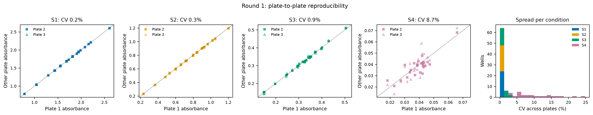

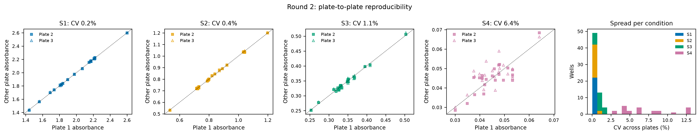

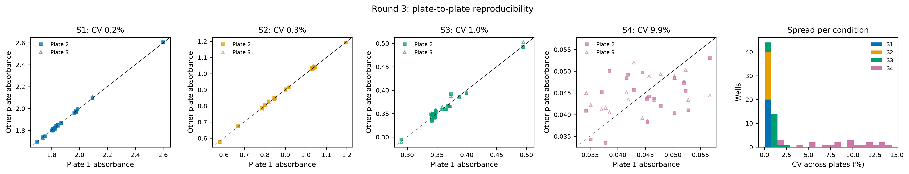

## Q2 control stability

Does the DMF control, the denominator of every relative value, stay constant across plates and rounds? Drift would rescale a whole round and make rounds incomparable.

- Every relative value is divided by its round's control, so control drift between rounds rescales the whole round.
- Drift beyond the within-round CV means a different solid load, evaporation or plate attack.

| solute | round1_mean | max_drift_vs_round1 | within_round_cv |
|---|---|---|---|
| S1 | 2.605 | 0.002 | 0.001 |
| S2 | 1.198 | 0.003 | 0.001 |
| S3 | 0.509 | 0.024 | 0.008 |
| S4 | 0.069 | 0.254 | 0.067 |

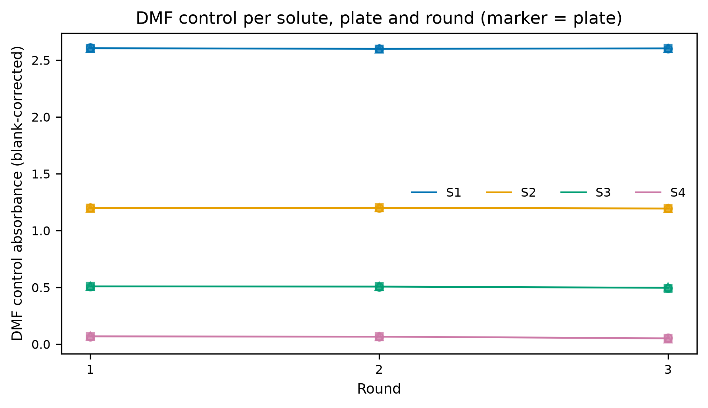

## Q3 blank wells and plate attack

How much absorbance comes from the solvent and the plate rather than the solute, does it grow with ester/ether content or read delay, and does it add up linearly so that the per-well blank is valid?

- b_<solvent>: blank absorbance of the pure solvent at that solute's wavelength (additive fit over all blank wells).
- QC-plate mixture blanks: measured minus additive prediction = 0.0038 absorbance on average (n = 396).
- Low R^2 or large residuals mean the blank is not additive in composition, i.e. plate attack or solvent interaction.
- Read-delay panel appears only when plate_log_roundN.csv files exist.

| solute | b_DMF | b_2MeTHF | b_EtOAc | b_DMC | b_CPME | b_MeCN | b_iPrOAc | resid_std | r2 |
|---|---|---|---|---|---|---|---|---|---|
| S1 | 0.135 | 0.138 | 0.137 | 0.136 | 0.139 | 0.130 | 0.140 | 0.002 | 0.635 |
| S2 | 0.098 | 0.096 | 0.099 | 0.101 | 0.103 | 0.096 | 0.100 | 0.002 | 0.264 |
| S3 | 0.078 | 0.084 | 0.086 | 0.084 | 0.084 | 0.081 | 0.084 | 0.002 | 0.322 |
| S4 | 0.064 | 0.062 | 0.068 | 0.070 | 0.068 | 0.070 | 0.075 | 0.003 | 0.369 |

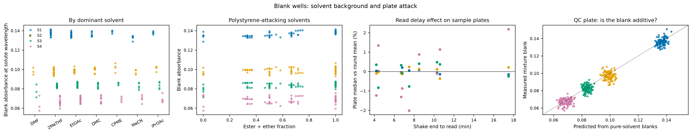

## Q4 spectral QC

Are any wells saturated, scattering (undissolved solid) or absorbing at the wrong wavelength? Each would inflate or bias that well's solubility without any extra solute dissolving.

- Saturation: raw absorbance above 2.5 (reader linear range placeholder, PLAN Q-b).
- Peak shift needs full spectra and a band of at least 0.05 absorbance (grey = too weak); scattering needs readings at 600-800 nm (add a 700 nm read in fixed-wavelength mode).
- High scattering = undissolved solid in the light path, which inflates that well.

| round | n_saturated | saturated_wells | n_peak_shift_gt10nm | median_abs_peak_shift_nm | max_scatter_abs |
|---|---|---|---|---|---|
| 1 | 3 | P1:A1 P2:A1 P3:A1 | 1 | 1.000 | 0.001 |
| 2 | 3 | P1:A1 P2:A1 P3:A1 | 4 | 1.000 | 0.001 |
| 3 | 3 | P1:A1 P2:A1 P3:A1 | 3 | 1.000 | 0.001 |

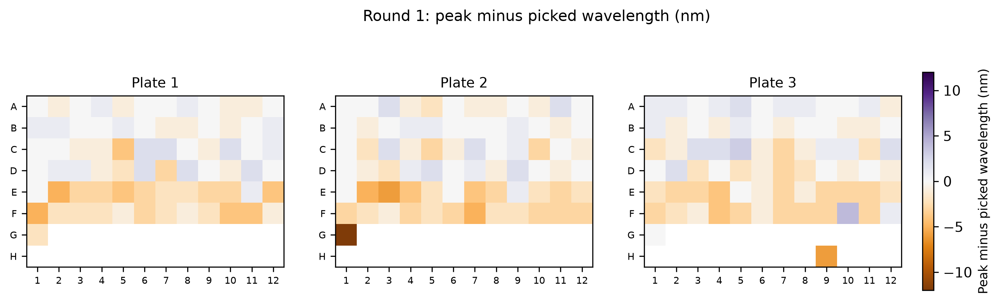

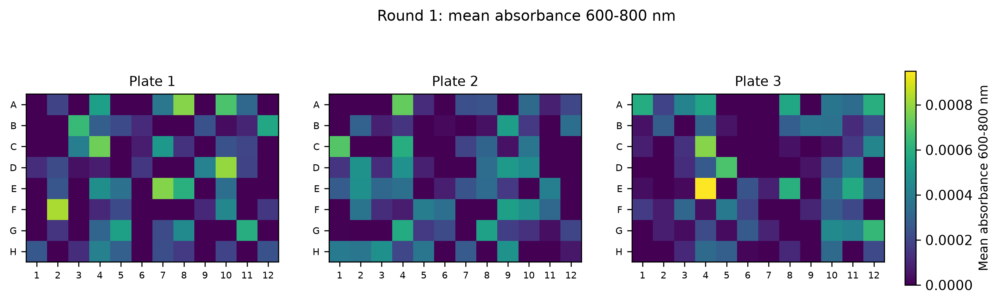

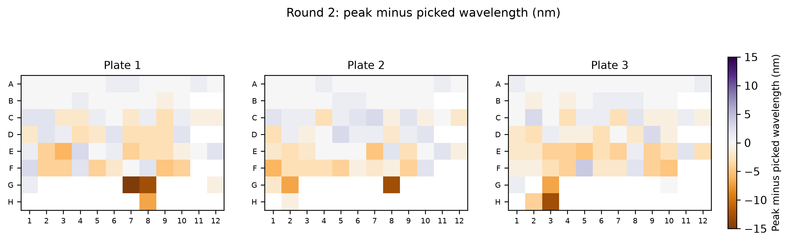

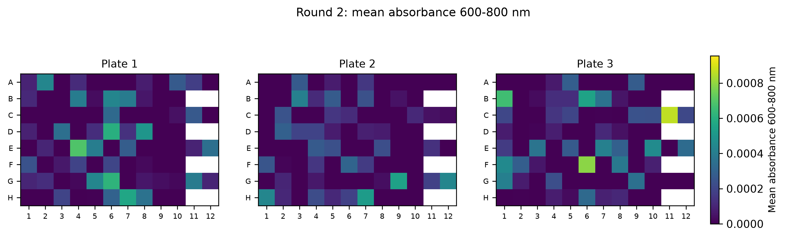

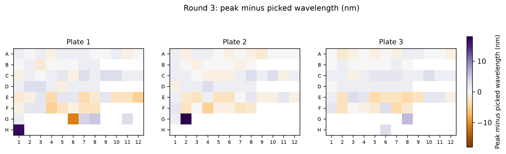

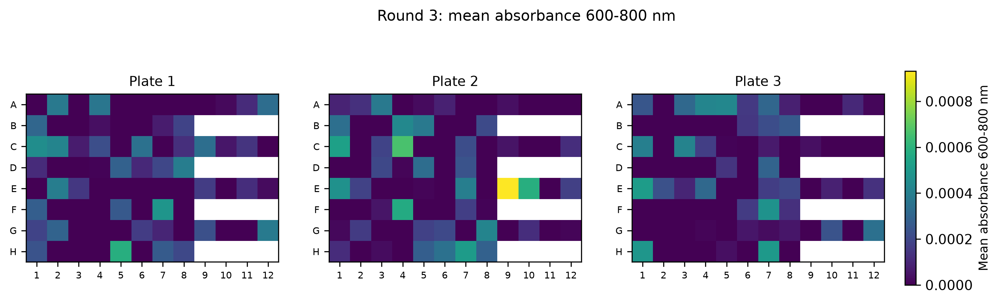

## Q5 precision against signal

Which conditions are measurable at all, and is the noise constant (reader) or proportional to the signal (pipetting and dissolution)?

- Detection limit = 3 x residual std of the blank model (Q3).
- log slope near 0: constant (reader) noise; near 1: proportional (pipetting/dissolution) noise.

| solute | detection_limit_abs | frac_below_lod | log_slope_std_vs_mean |
|---|---|---|---|
| S1 | 0.005 | 0.000 | -0.070 |
| S2 | 0.007 | 0.000 | 0.074 |
| S3 | 0.007 | 0.000 | 0.109 |
| S4 | 0.009 | 0.000 | 0.031 |

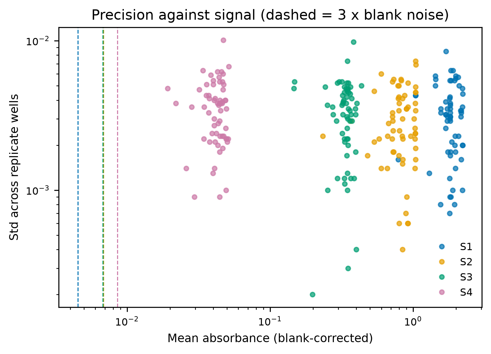

## Q6 cross-round re-tests

Does a mixture measured again in a later round, on new solid and a new plate, give the same answer? This is the only check that rounds can be pooled.

- Re-tests repeat a mixture on new solid, a new plate and a refilled reservoir: the only check across rounds.
- Grey band: 2 x the median plate-to-plate CV (Q1); frac_within_2cv uses each solute's own CV.

| solute | n_retests | mean_abs_diff | plate_cv | frac_within_2cv |
|---|---|---|---|---|
| S1 | 10 | 0.003 | 0.002 | 0.300 |
| S2 | 10 | 0.005 | 0.003 | 0.300 |
| S3 | 10 | 0.011 | 0.010 | 0.700 |
| S4 | 10 | 0.100 | 0.087 | 0.700 |

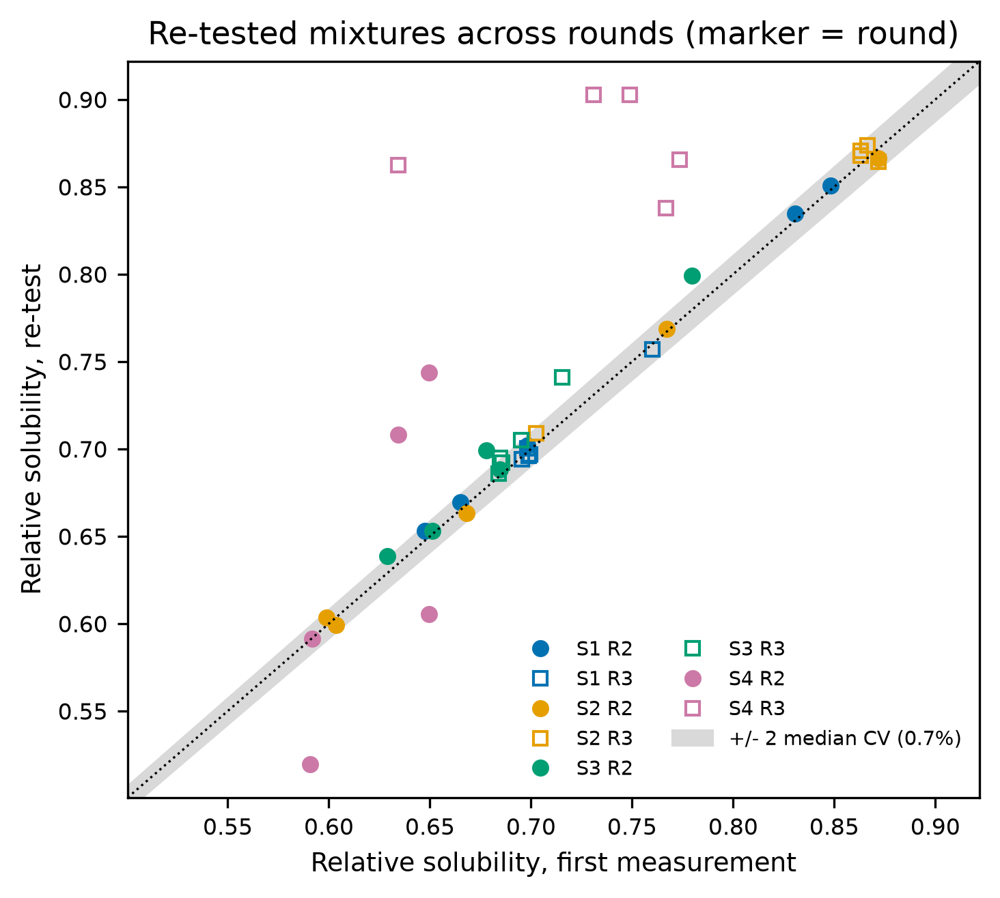

## Q7 calibration

Is absorbance proportional to the amount of solute, in which solvents does the solute stop dissolving at the working loading, and is the DMF control fully dissolved?

- slope_per_loading: blank-corrected absorbance per unit of nominal solid mass, from the lowest loading (most likely fully dissolved).
- top_to_bottom_linearity: 1.0 = the highest loading reads in proportion to the lowest; well below 1 = solubility-limited (the series bends over). linear_up_to: largest loading within 5 % of that line.
- dmf_control_recovery: sample-plate DMF control / DMF calibration slope; 1.0 means the control is fully dissolved.

| solvent | solute | slope_per_loading | top_to_bottom_linearity | linear_up_to | n_levels | round | dmf_control_recovery |
|---|---|---|---|---|---|---|---|
| 2MeTHF | S1 | 2.611 | 0.699 | 0.500 | 2 | 1 | 0.999 |
| 2MeTHF | S2 | 0.739 | 0.485 | 0.500 | 2 | 1 | 0.991 |
| 2MeTHF | S3 | 0.491 | 0.514 | 0.500 | 2 | 1 | 1.002 |
| 2MeTHF | S4 | 0.057 | 0.622 | 0.500 | 2 | 1 | 0.869 |
| CPME | S1 | 2.598 | 0.498 | 0.500 | 2 | 1 | 0.999 |
| CPME | S2 | 0.458 | 0.501 | 0.500 | 2 | 1 | 0.991 |
| CPME | S3 | 0.500 | 0.688 | 0.500 | 2 | 1 | 1.002 |
| CPME | S4 | 0.035 | 0.534 | 0.500 | 2 | 1 | 0.869 |
| DMC | S1 | 2.594 | 0.599 | 0.500 | 2 | 1 | 0.999 |
| DMC | S2 | 1.199 | 0.501 | 0.500 | 2 | 1 | 0.991 |
| DMC | S3 | 0.386 | 0.511 | 0.500 | 2 | 1 | 1.002 |
| DMC | S4 | 0.047 | 0.732 | 0.500 | 2 | 1 | 0.869 |
| DMF | S1 | 2.607 | 0.997 | 1.000 | 2 | 1 | 0.999 |
| DMF | S2 | 1.209 | 0.990 | 1.000 | 2 | 1 | 0.991 |
| DMF | S3 | 0.508 | 1.017 | 1.000 | 2 | 1 | 1.002 |
| DMF | S4 | 0.079 | 0.814 | 0.500 | 2 | 1 | 0.869 |
| EtOAc | S1 | 2.091 | 0.503 | 0.500 | 2 | 1 | 0.999 |
| EtOAc | S2 | 1.173 | 0.612 | 0.500 | 2 | 1 | 0.991 |
| EtOAc | S3 | 0.275 | 0.549 | 0.500 | 2 | 1 | 1.002 |
| EtOAc | S4 | 0.055 | 0.606 | 0.500 | 2 | 1 | 0.869 |
| MeCN | S1 | 1.574 | 0.498 | 0.500 | 2 | 1 | 0.999 |
| MeCN | S2 | 1.215 | 0.690 | 0.500 | 2 | 1 | 0.991 |
| MeCN | S3 | 0.514 | 0.589 | 0.500 | 2 | 1 | 1.002 |
| MeCN | S4 | 0.049 | 0.607 | 0.500 | 2 | 1 | 0.869 |
| iPrOAc | S1 | 2.084 | 0.496 | 0.500 | 2 | 1 | 0.999 |
| iPrOAc | S2 | 0.973 | 0.490 | 0.500 | 2 | 1 | 0.991 |
| iPrOAc | S3 | 0.294 | 0.489 | 0.500 | 2 | 1 | 1.002 |
| iPrOAc | S4 | 0.047 | 0.692 | 0.500 | 2 | 1 | 0.869 |
| 2MeTHF | S1 | 2.590 | 0.703 | 0.500 | 2 | 2 | 1.000 |
| 2MeTHF | S2 | 0.702 | 0.509 | 0.500 | 2 | 2 | 1.001 |
| 2MeTHF | S3 | 0.492 | 0.491 | 0.500 | 2 | 2 | 0.966 |
| 2MeTHF | S4 | 0.060 | 0.439 | 0.500 | 2 | 2 | 1.214 |
| CPME | S1 | 2.601 | 0.499 | 0.500 | 2 | 2 | 1.000 |
| CPME | S2 | 0.489 | 0.489 | 0.500 | 2 | 2 | 1.001 |
| CPME | S3 | 0.488 | 0.703 | 0.500 | 2 | 2 | 0.966 |
| CPME | S4 | 0.023 | 0.932 | 0.500 | 2 | 2 | 1.214 |
| DMC | S1 | 2.610 | 0.599 | 0.500 | 2 | 2 | 1.000 |
| DMC | S2 | 1.191 | 0.497 | 0.500 | 2 | 2 | 1.001 |
| DMC | S3 | 0.408 | 0.499 | 0.500 | 2 | 2 | 0.966 |
| DMC | S4 | 0.047 | 0.699 | 0.500 | 2 | 2 | 1.214 |
| DMF | S1 | 2.598 | 0.999 | 1.000 | 2 | 2 | 1.000 |
| DMF | S2 | 1.198 | 0.997 | 1.000 | 2 | 2 | 1.001 |
| DMF | S3 | 0.525 | 0.958 | 0.500 | 2 | 2 | 0.966 |
| DMF | S4 | 0.055 | 1.216 | 0.500 | 2 | 2 | 1.214 |
| EtOAc | S1 | 2.078 | 0.505 | 0.500 | 2 | 2 | 1.000 |
| EtOAc | S2 | 1.209 | 0.596 | 0.500 | 2 | 2 | 1.001 |
| EtOAc | S3 | 0.308 | 0.487 | 0.500 | 2 | 2 | 0.966 |
| EtOAc | S4 | 0.065 | 0.572 | 0.500 | 2 | 2 | 1.214 |
| MeCN | S1 | 1.570 | 0.498 | 0.500 | 2 | 2 | 1.000 |
| MeCN | S2 | 1.198 | 0.700 | 0.500 | 2 | 2 | 1.001 |
| MeCN | S3 | 0.491 | 0.634 | 0.500 | 2 | 2 | 0.966 |
| MeCN | S4 | 0.073 | 0.439 | 0.500 | 2 | 2 | 1.214 |
| iPrOAc | S1 | 2.062 | 0.501 | 0.500 | 2 | 2 | 1.000 |
| iPrOAc | S2 | 0.931 | 0.502 | 0.500 | 2 | 2 | 1.001 |
| iPrOAc | S3 | 0.310 | 0.498 | 0.500 | 2 | 2 | 0.966 |
| iPrOAc | S4 | 0.051 | 0.820 | 0.500 | 2 | 2 | 1.214 |
| 2MeTHF | S1 | 2.595 | 0.700 | 0.500 | 2 | 3 | 1.009 |
| 2MeTHF | S2 | 0.723 | 0.506 | 0.500 | 2 | 3 | 0.997 |
| 2MeTHF | S3 | 0.520 | 0.479 | 0.500 | 2 | 3 | 1.005 |
| 2MeTHF | S4 | 0.036 | 0.441 | 0.500 | 2 | 3 | 1.023 |
| CPME | S1 | 2.606 | 0.499 | 0.500 | 2 | 3 | 1.009 |
| CPME | S2 | 0.479 | 0.484 | 0.500 | 2 | 3 | 0.997 |
| CPME | S3 | 0.497 | 0.705 | 0.500 | 2 | 3 | 1.005 |
| CPME | S4 | 0.044 | 0.454 | 0.500 | 2 | 3 | 1.023 |
| DMC | S1 | 2.600 | 0.598 | 0.500 | 2 | 3 | 1.009 |
| DMC | S2 | 1.192 | 0.493 | 0.500 | 2 | 3 | 0.997 |
| DMC | S3 | 0.394 | 0.486 | 0.500 | 2 | 3 | 1.005 |
| DMC | S4 | 0.049 | 0.533 | 0.500 | 2 | 3 | 1.023 |
| DMF | S1 | 2.581 | 1.007 | 1.000 | 2 | 3 | 1.009 |
| DMF | S2 | 1.197 | 1.000 | 1.000 | 2 | 3 | 0.997 |
| DMF | S3 | 0.494 | 1.014 | 1.000 | 2 | 3 | 1.005 |
| DMF | S4 | 0.050 | 1.046 | 0.500 | 2 | 3 | 1.023 |
| EtOAc | S1 | 2.090 | 0.498 | 0.500 | 2 | 3 | 1.009 |
| EtOAc | S2 | 1.187 | 0.605 | 0.500 | 2 | 3 | 0.997 |
| EtOAc | S3 | 0.283 | 0.508 | 0.500 | 2 | 3 | 1.005 |
| EtOAc | S4 | 0.077 | 0.490 | 0.500 | 2 | 3 | 1.023 |
| MeCN | S1 | 1.559 | 0.505 | 0.500 | 2 | 3 | 1.009 |
| MeCN | S2 | 1.205 | 0.698 | 0.500 | 2 | 3 | 0.997 |
| MeCN | S3 | 0.496 | 0.603 | 0.500 | 2 | 3 | 1.005 |
| MeCN | S4 | 0.064 | 0.396 | 0.500 | 2 | 3 | 1.023 |
| iPrOAc | S1 | 2.062 | 0.502 | 0.500 | 2 | 3 | 1.009 |
| iPrOAc | S2 | 0.948 | 0.498 | 0.500 | 2 | 3 | 0.997 |
| iPrOAc | S3 | 0.293 | 0.517 | 0.500 | 2 | 3 | 1.005 |
| iPrOAc | S4 | 0.033 | 1.485 | 0.500 | 2 | 3 | 1.023 |

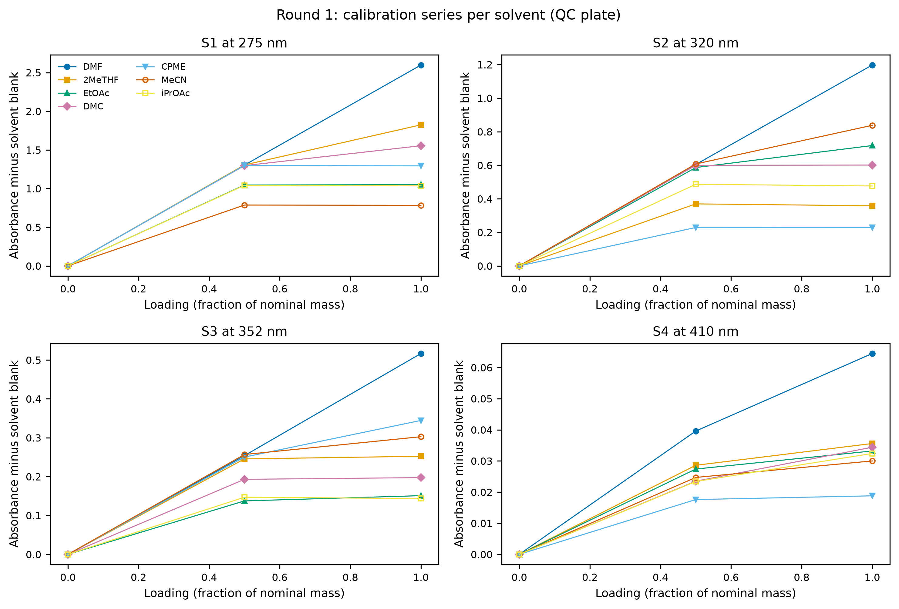

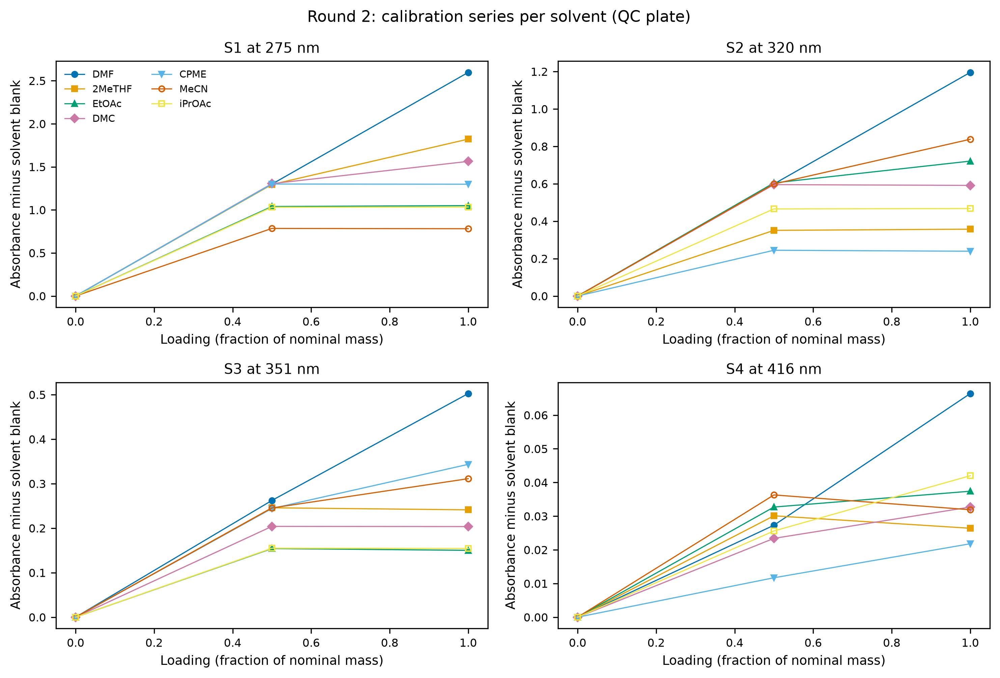

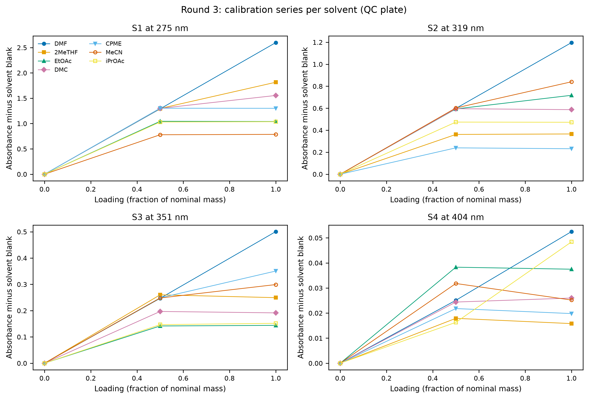
