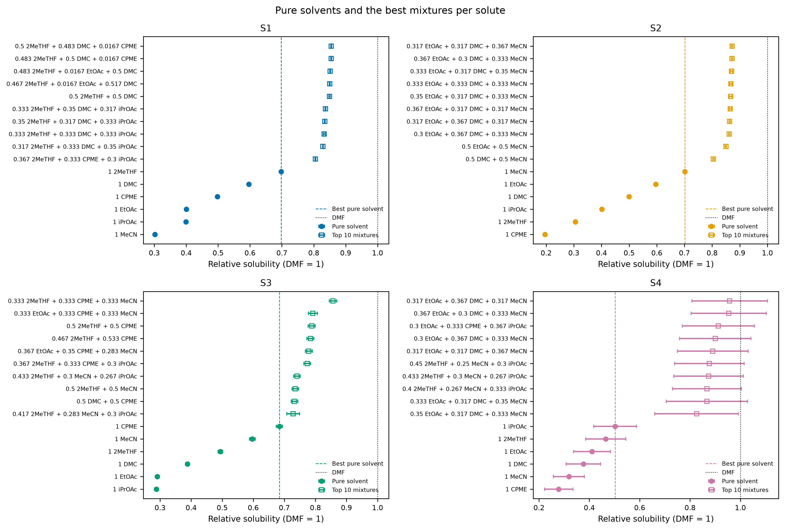
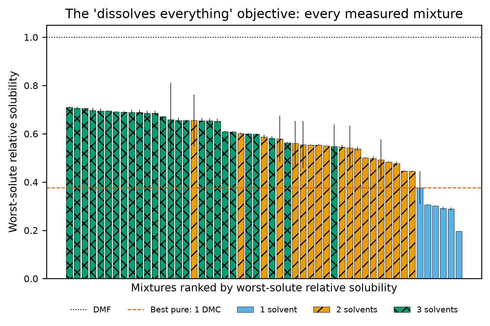
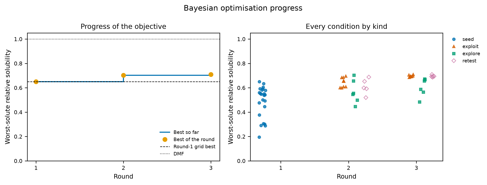
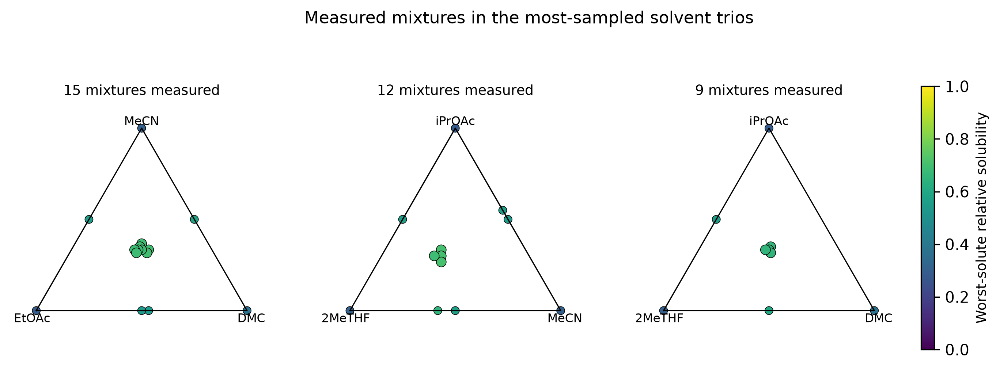
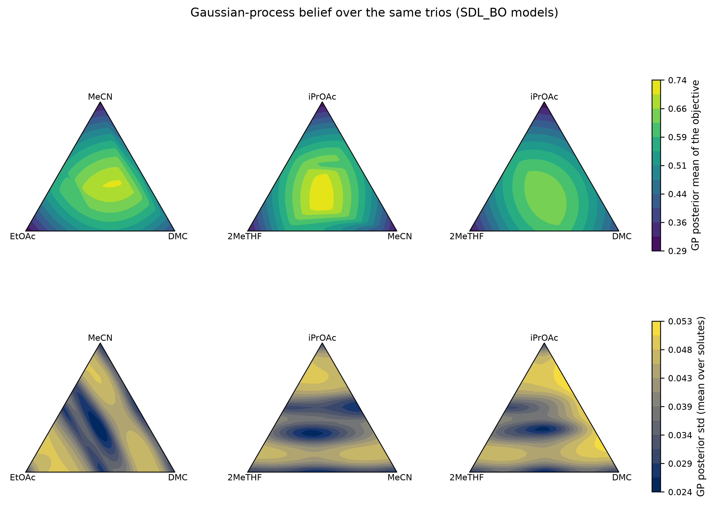
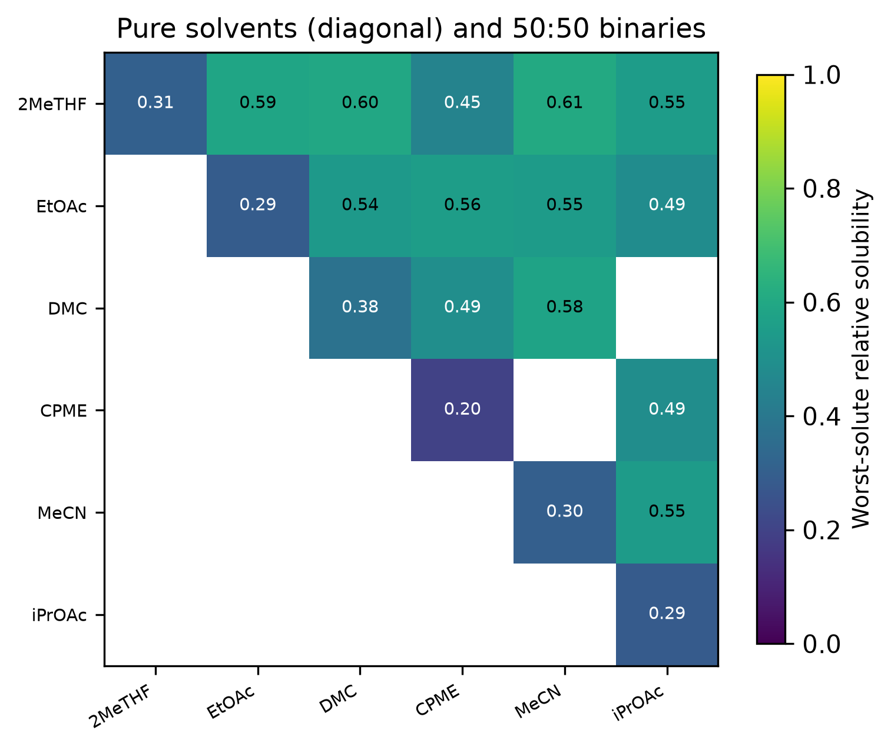
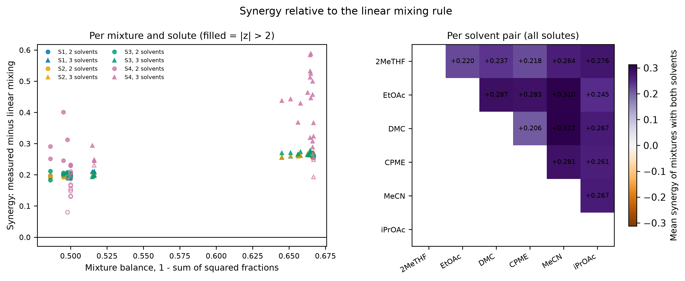
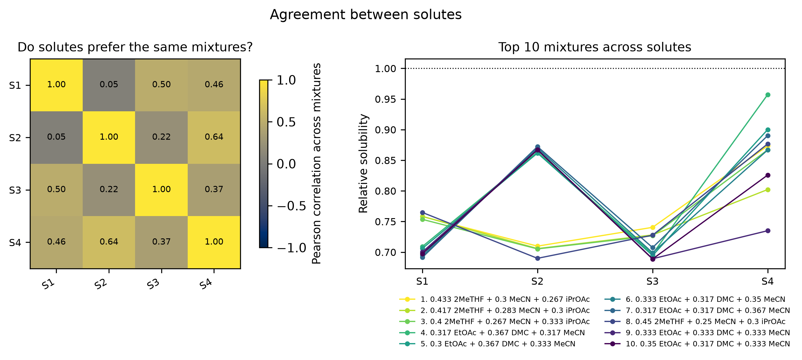
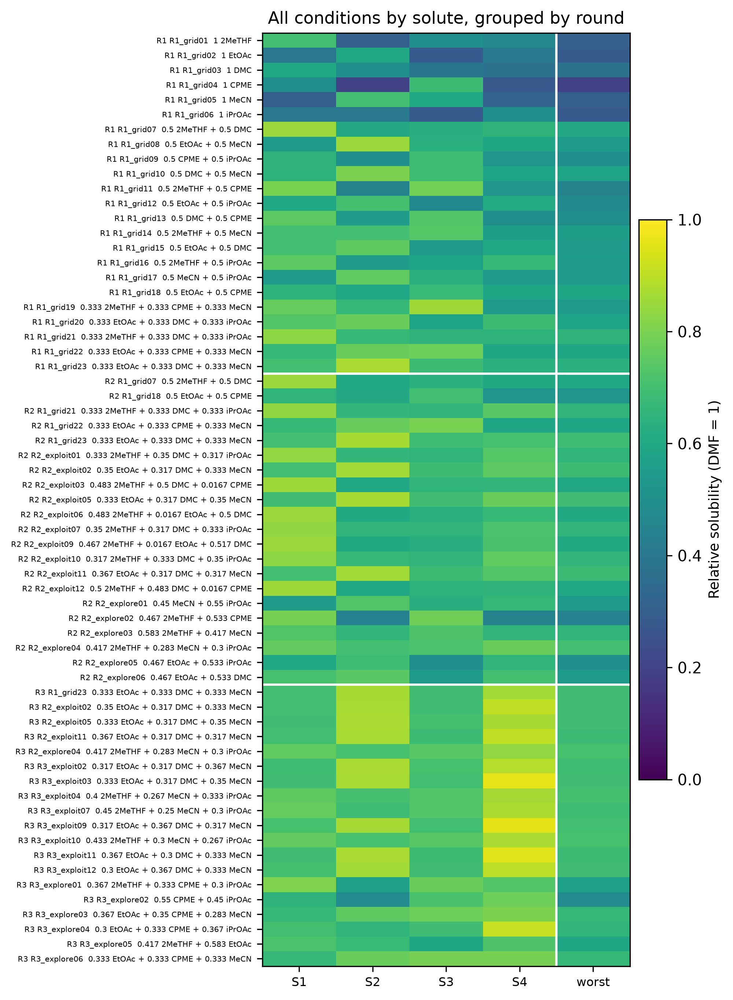

# Report: toy_synergy_output (rounds 1, 2, 3)

## R1 mixtures vs single solvents, per solute

For each solute on its own, does any green-solvent mixture dissolve more than the best single green solvent, and how close does it come to DMF?

- z = difference over the combined error (within-plate and between-round spread); a mixture beats the best pure solvent when z > 2.

| solute | best_mixture | rel_mixture | best_pure | rel_pure | ratio | z | mixture_beats_pure |
|---|---|---|---|---|---|---|---|
| S1 | 0.5 2MeTHF + 0.483 DMC + 0.0167 CPME | 0.855 | 1 2MeTHF | 0.698 | 1.225 | 91.561 | True |
| S2 | 0.317 EtOAc + 0.317 DMC + 0.367 MeCN | 0.872 | 1 MeCN | 0.701 | 1.244 | 47.238 | True |
| S3 | 0.333 2MeTHF + 0.333 CPME + 0.333 MeCN | 0.857 | 1 CPME | 0.684 | 1.252 | 10.916 | True |
| S4 | 0.317 EtOAc + 0.367 DMC + 0.317 MeCN | 0.957 | 1 iPrOAc | 0.502 | 1.906 | 2.637 | True |

## R2 the 'dissolves everything' objective

Is there one mixture that dissolves all solutes well at once, i.e. whose worst solute still beats the best single solvent's worst solute? This is the proposal's success criterion.

- Best overall: 0.433 2MeTHF + 0.3 MeCN + 0.267 iPrOAc (0.710); best pure solvent: 1 DMC (0.376); z = 4.9 -> a mixture beats every single solvent.

| rank | mixture | obj_min_rel | obj_err | worst_solute | n_solvents | first_round |
|---|---|---|---|---|---|---|
| 1 | 0.433 2MeTHF + 0.3 MeCN + 0.267 iPrOAc | 0.710 | 0.002 | S2 | 3 | 3 |
| 2 | 0.417 2MeTHF + 0.283 MeCN + 0.3 iPrOAc | 0.706 | 0.005 | S2 | 3 | 2 |
| 3 | 0.4 2MeTHF + 0.267 MeCN + 0.333 iPrOAc | 0.705 | 0.002 | S2 | 3 | 3 |
| 4 | 0.317 EtOAc + 0.367 DMC + 0.317 MeCN | 0.697 | 0.010 | S3 | 3 | 3 |
| 5 | 0.3 EtOAc + 0.367 DMC + 0.333 MeCN | 0.695 | 0.010 | S3 | 3 | 3 |
| 6 | 0.333 EtOAc + 0.317 DMC + 0.35 MeCN | 0.694 | 0.001 | S1 | 3 | 2 |
| 7 | 0.317 EtOAc + 0.317 DMC + 0.367 MeCN | 0.691 | 0.001 | S1 | 3 | 3 |
| 8 | 0.45 2MeTHF + 0.25 MeCN + 0.3 iPrOAc | 0.690 | 0.002 | S2 | 3 | 3 |
| 9 | 0.333 EtOAc + 0.333 DMC + 0.333 MeCN | 0.689 | 0.010 | S3 | 3 | 1 |
| 10 | 0.35 EtOAc + 0.317 DMC + 0.333 MeCN | 0.689 | 0.010 | S3 | 3 | 2 |

## R3 BO progress

Is the Bayesian optimisation learning: does the best objective improve round on round, and do its exploit picks outperform its explore picks and the seed grid?

- Exploit picks should sit above explore picks once the model has learnt something; re-tests show cross-round repeatability.

| round | kind | n | mean | best |
|---|---|---|---|---|
| 1 | seed | 23 | 0.487 | 0.649 |
| 2 | exploit | 10 | 0.645 | 0.695 |
| 2 | explore | 6 | 0.567 | 0.703 |
| 2 | retest | 5 | 0.610 | 0.688 |
| 3 | exploit | 8 | 0.696 | 0.710 |
| 3 | explore | 6 | 0.605 | 0.672 |
| 3 | retest | 5 | 0.695 | 0.709 |

## R4 composition landscape

Where in composition space do the good mixtures lie, and what does the model believe about the regions it has not measured?

- Ternaries: colour = worst-solute relative solubility; larger points are 3-solvent mixtures. GP panels show the model the BO used.

| trio | n_mixtures |
|---|---|
| EtOAc / DMC / MeCN | 15 |
| 2MeTHF / MeCN / iPrOAc | 12 |
| 2MeTHF / DMC / iPrOAc | 9 |

## R5 synergy

Do mixtures dissolve more than the fraction-weighted average of their pure solvents would predict, i.e. is there genuine synergy, and between which solvent pairs?

- Synergy > 0: the mixture dissolves more than the fraction-weighted average of its pure solvents would predict.
- Significant when |z| = |synergy| / its error > 2; the error combines the mixture's and its pure solvents' pooled errors. Typical threshold here: 0.014 in relative solubility (median error 0.007).
- By chance about 5 % of mixtures (2 per solute) pass |z| > 2. Mixtures sharing a pure solvent share its single measurement, so a cluster of same-sign 'significant' synergies around one solvent may just mean that solvent's pure value is off; re-measuring the pure solvents settles it.

| solute | n_mixtures | n_significant | n_significant_positive | mean_synergy | max_synergy | max_z | most_synergistic |
|---|---|---|---|---|---|---|---|
| S1 | 45 | 45 | 45 | 0.233 | 0.270 | 193.238 | 0.317 2MeTHF + 0.333 DMC + 0.35 iPrOAc |
| S2 | 45 | 45 | 45 | 0.232 | 0.272 | 97.373 | 0.333 EtOAc + 0.333 DMC + 0.333 iPrOAc |
| S3 | 45 | 45 | 45 | 0.232 | 0.278 | 22.934 | 0.367 2MeTHF + 0.333 CPME + 0.3 iPrOAc |
| S4 | 45 | 30 | 30 | 0.307 | 0.588 | 3.791 | 0.317 EtOAc + 0.367 DMC + 0.317 MeCN |

## R6 agreement between solutes

Do the solutes prefer the same solvents, or is dissolving all of them a trade-off? Low correlation explains why the worst-solute objective is hard.

- Low or negative correlation means the solutes want different solvents: the worst-solute objective is then a real trade-off.

| solute | S1 | S2 | S3 | S4 |
|---|---|---|---|---|
| S1 | 1.000 | 0.053 | 0.500 | 0.458 |
| S2 | 0.053 | 1.000 | 0.219 | 0.640 |
| S3 | 0.500 | 0.219 | 1.000 | 0.367 |
| S4 | 0.458 | 0.640 | 0.367 | 1.000 |

## R7 dataset

The dataset deliverable: every condition measured on every solute, across rounds, as one picture and the files behind it.

- 63 condition rows over 3 round(s), 4 solutes.
- Deliverable files in the run folder: `bo_dataset.csv`, `bo_dataset_shared.csv`, `plate_map_round1.csv`, `plate_map_round2.csv`, `plate_map_round3.csv`, `results_round1_wells.csv`, `results_round2_wells.csv`, `results_round3_wells.csv`; QC numbers in `qc_summary.md`.

